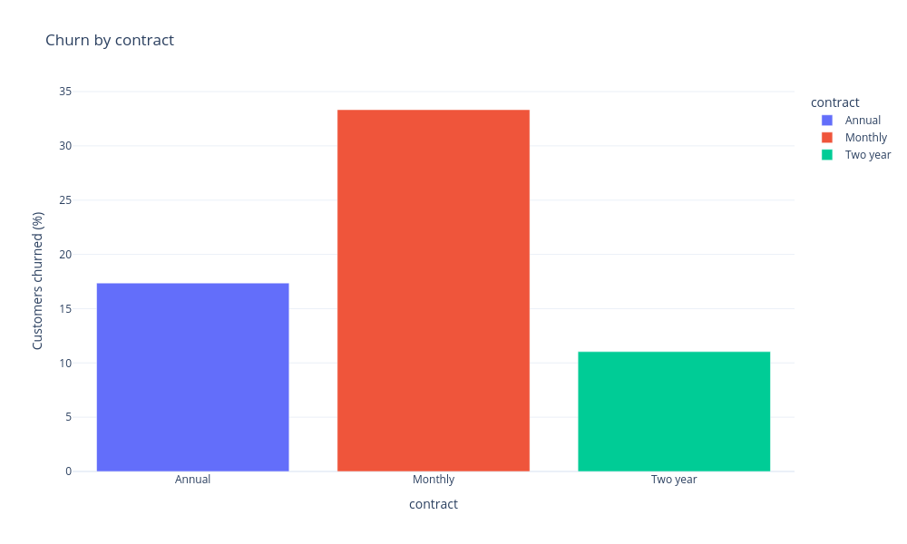
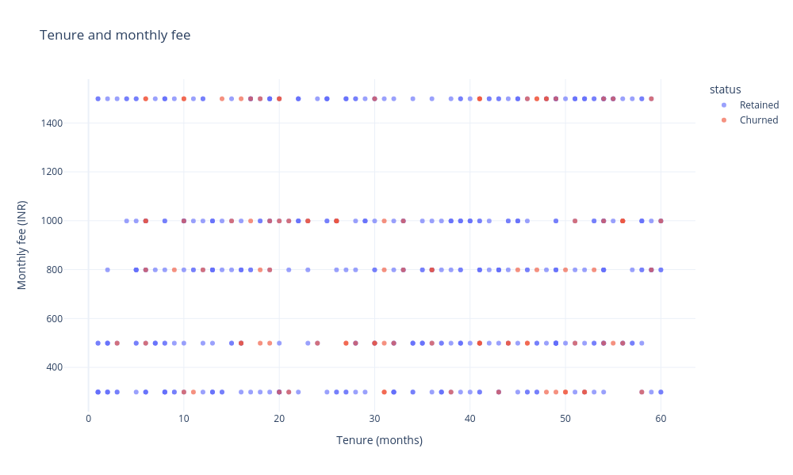
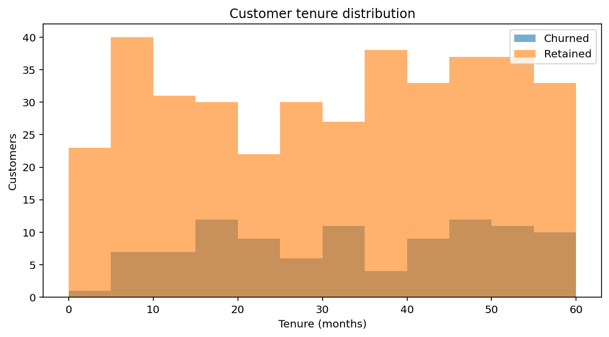
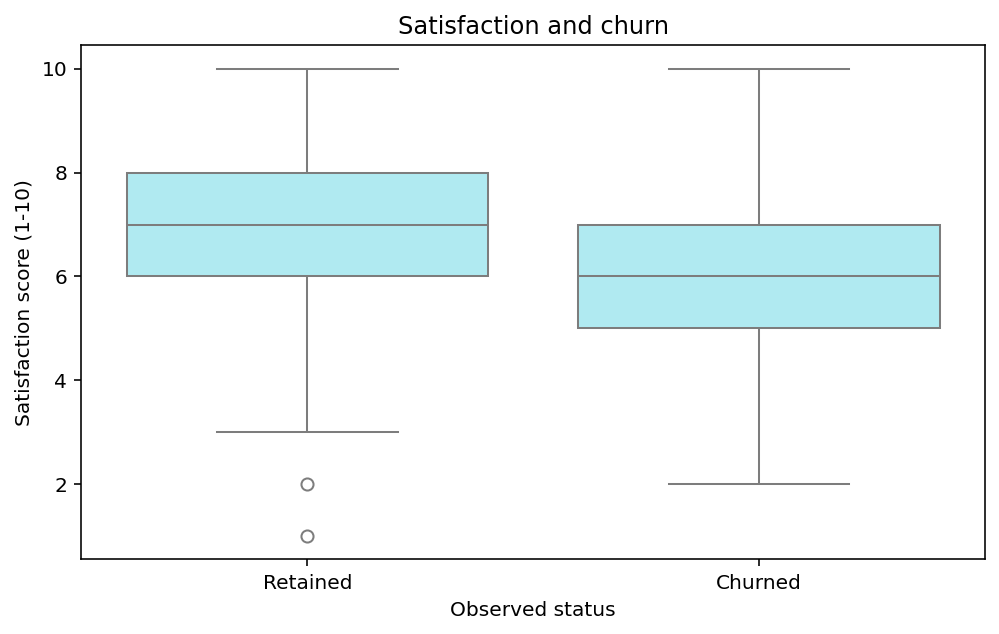
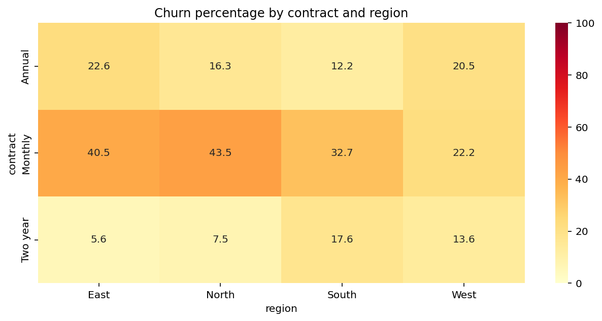

# Customer Churn Explorer - a worked Python and Streamlit tutorial

Read a business question, run a commented Python cell, inspect its **actual output**, and explain what the result means. That is the structure of this tutorial.

The analysis uses [customer_churn.csv](customer_churn.csv) and the formulas in [app.py](app.py). The examined app source is [revision c10a61c36fffdd048b69dd78926e6663bc986fce](https://github.com/cookieSensei/programming-and-ai/blob/c10a61c36fffdd048b69dd78926e6663bc986fce/business_analytics_workshop/03_customer_churn/app.py). All 480 customers are **fictional teaching records**. Outputs below were generated by executing the displayed cells against that CSV.

## How to use the cells

Markdown displays static code and results; it does not execute Python by itself. Open a Jupyter notebook in this project folder and run the **analysis cells in order in one Python session**. Each cell can use variables created above it. Start with the working directory containing `customer_churn.csv`. The last expression `fig` displays a figure in a notebook; this guide includes a PNG of the figure actually generated.

The final **Streamlit-only cell** is a complete, separate teaching app. It has its own imports and data loading. Save that cell as `practice_churn_app.py` beside the CSV and launch it with Streamlit. It reconstructs the analytical workflow in a compact interface; the original `app.py` also contains case-study text, chart explanations and its twelve-section report.

The [workshop instructions](../README.md) specify Python 3.12 and this environment:

```bash
python -m venv .venv
source .venv/bin/activate
python -m pip install streamlit==1.50.0 pandas==2.2.3 numpy==2.3.5 matplotlib==3.10.8 seaborn==0.13.2 plotly==6.5.2
```

Use a Python 3.12 interpreter for the first command. On Windows, follow the [WSL guidance](../../README.md) for a full checkout because other phase-folder names contain `>`. A notebook interface such as the supplied Cloud Lab's JupyterLab is separate from these analysis dependencies.

## 1. Start with the business question

A subscription team wants to know **where observed churn is concentrated**. An overall percentage can hide differences between contracts and regions. The team also wants to compare tenure and satisfaction without mistaking a pattern for a proven cause.

One row is one customer in one snapshot. `churned=1` means marked churned; `churned=0` means marked retained. There is no cancellation date or observation window. We can calculate a snapshot proportion, but not a monthly churn rate, customer lifetime value or future churn prediction.

| Source field | Meaning and unit |
| --- | --- |
| `customer_id` | Synthetic customer identifier |
| `region` | Customer region |
| `contract` | Monthly, Annual or Two year |
| `tenure_months` | Recorded tenure in months |
| `monthly_fee` | Listed monthly charge in INR |
| `support_tickets` | Ticket count without a common documented time window |
| `satisfaction_score` | Recorded score on the intended 1-10 scale |
| `churned` | Intended binary flag, 0 or 1 |

Pandas performs the table operations: reading, selecting, grouping and calculating. Streamlit supplies the browser interface. Plotly creates interactive figures, while Matplotlib and Seaborn provide statistical plots. The libraries help express the analysis; they do not decide what counts as churn or prove why a customer left.

## 2. Load the evidence before calculating results

### Cell 01 - Import the tools and locate the CSV

**Question:** Which tools will do the analysis, and are we reading the intended file?

<!-- cell:analysis:01 -->

```python
from pathlib import Path             # Handle a file path without a machine-specific directory.
import pandas as pd                  # Read and manipulate tables.
import matplotlib.pyplot as plt      # Create figures and axes.
import seaborn as sns                # Draw statistical boxes and a heatmap.
import plotly.express as px           # Build charts from named DataFrame columns.

DATA_FILE = Path("customer_churn.csv")  # Notebook cells run from this project folder.
print("CSV found:", DATA_FILE.is_file())
print("pandas version:", pd.__version__)
```

**Output**

```text
CSV found: True
pandas version: 2.2.3
```

**Interpretation and reasoning**

The aliases `pd`, `plt`, `sns` and `px` are short names, not different libraries. A relative `Path` is appropriate here because the notebook working directory is explicit. The original script instead uses `Path(__file__).resolve().with_name(...)` to find its sibling CSV when launched elsewhere; notebooks generally do not define `__file__`.

### Cell 02 - Read the table and inspect five customers

**Question:** What does one observation look like before we summarize it?

<!-- cell:analysis:02 -->

```python
frame = pd.read_csv(DATA_FILE)        # Parse CSV text into a labeled table.
print("Rows:", len(frame))            # len(DataFrame) counts records.
print("Columns:", len(frame.columns))
print(frame.head(5).to_string(index=False))  # Display five rows without a pandas index column.
```

**Output**

```text
Rows: 480
Columns: 8
customer_id region contract  tenure_months  monthly_fee  support_tickets  satisfaction_score  churned
  CUST-0001   East Two year             13          799                0                   8        0
  CUST-0002  South  Monthly             27          499                1                   7        1
  CUST-0003   West   Annual             49          499                1                   7        0
  CUST-0004  North Two year             12          999                1                   9        0
  CUST-0005  South  Monthly             54          499                1                   7        0
```

**Interpretation and reasoning**

A `DataFrame` is a table with named columns. `head(5)` inspects five records without changing `frame`. The second customer is marked churned; the other four are retained. Repeated contract names are segment labels, while customer IDs identify individual records.

### Cell 03 - Check types and the one-customer-per-row assumption

**Question:** Are we counting customers, and did pandas recognize the measures as numbers?

<!-- cell:analysis:03 -->

```python
types = frame.dtypes.astype(str).rename("dtype")  # Make dtype objects readable.
print(types.to_string())
print()
print("Rows:", len(frame))
print("Distinct customer IDs:", frame["customer_id"].nunique())
print("Repeated customer IDs:", frame["customer_id"].duplicated().sum())
```

**Output**

```text
customer_id           object
region                object
contract              object
tenure_months          int64
monthly_fee            int64
support_tickets        int64
satisfaction_score     int64
churned                int64

Rows: 480
Distinct customer IDs: 480
Repeated customer IDs: 0
```

**Interpretation and reasoning**

Selecting one column returns a `Series`. Its `nunique()` result confirms that this file has one distinct ID per row. ID uniqueness is an additional teaching check: the original app reports exact duplicate rows but does not enforce unique customer IDs. Appending multiple snapshots would change what counting rows means.

### Cell 04 - Validate the input used by the existing app

**Question:** Can the fields be analyzed without silently discarding incomplete rows?

<!-- cell:analysis:04 -->

```python
required_columns = [
    "customer_id", "region", "contract", "tenure_months",
    "monthly_fee", "support_tickets", "satisfaction_score", "churned",
]
numeric_columns = [
    "tenure_months", "monthly_fee", "support_tickets",
    "satisfaction_score", "churned",
]

# Reject incomplete schemas instead of calculating from missing fields.
if not set(required_columns).issubset(frame.columns):
    raise ValueError("The CSV is missing required columns.")
if frame.empty:
    raise ValueError("The CSV contains no rows.")

for column in numeric_columns:
    # Reject unparseable text rather than silently replacing it with missing values.
    frame[column] = pd.to_numeric(frame[column], errors="raise")

if frame[required_columns].isna().any().any():
    # First any() reduces each column; the second asks whether any column failed.
    raise ValueError("Fill missing values in the required analysis columns first.")

print("Required-column, nonempty and numeric checks passed.")
print("Missing source cells:", frame.isna().sum().sum())
print("Exact duplicate source rows:", frame.duplicated().sum())
```

**Output**

```text
Required-column, nonempty and numeric checks passed.
Missing source cells: 0
Exact duplicate source rows: 0
```

**Interpretation and reasoning**

These checks match the app's central loading rules. They do not remove duplicates, fill missing values or enforce business ranges. A numeric value of 2 in churned would pass conversion; a later cell demonstrates the consequence. The original app catches specified loading exceptions, displays `st.error(...)`, and uses `st.stop()` to end the current run.

## 3. Select a population and answer its questions

A filter defines the denominator of the analysis. We first reproduce the app's default of selecting every region and contract. Later we create a separate focused subset without silently changing the population behind earlier outputs.

A Boolean mask gives each row `True` or `False`. Selecting `table[mask]` keeps True rows. Applying two filters in sequence means both conditions must hold.

### Cell 05 - Reproduce the default sidebar selections in Python

**Question:** Which customers will contribute to the cards, charts and report?

<!-- cell:analysis:05 -->

```python
selected_regions = sorted(frame["region"].unique())
selected_contracts = sorted(frame["contract"].unique())

filtered = frame.copy()  # Preserve the source table for source-quality reporting.
filtered = filtered[filtered["region"].isin(selected_regions)]
filtered = filtered[filtered["contract"].isin(selected_contracts)]
if filtered.empty:
    raise ValueError("No rows match these selections.")

print("Regions:", ", ".join(selected_regions))
print("Contracts:", ", ".join(selected_contracts))
print(f"Selected customers: {len(filtered)} of {len(frame)}")
```

**Output**

```text
Regions: East, North, South, West
Contracts: Annual, Monthly, Two year
Selected customers: 480 of 480
```

**Interpretation and reasoning**

`isin(...)` tests membership in the chosen list. The app's multiselect widgets supply these lists. Clearing every option selects no rows; it does not mean select all. The app stops an empty selection before attempting rankings or plots.

### Cell 06 - Translate the binary flag into readable chart labels

**Question:** How can a chart show meaningful group names instead of 0 and 1?

<!-- cell:analysis:06 -->

```python
# map() applies the dictionary to each flag and preserves the original numeric field.
filtered["status"] = filtered["churned"].map({0: "Retained", 1: "Churned"})
print(filtered[["customer_id", "churned", "status"]].head(5).to_string(index=False))
```

**Output**

```text
customer_id  churned   status
  CUST-0001        0 Retained
  CUST-0002        1  Churned
  CUST-0003        0 Retained
  CUST-0004        0 Retained
  CUST-0005        0 Retained
```

**Interpretation and reasoning**

The new status column is for readable display and grouping. The original churned field remains numeric. An unmatched value maps to missing, so binary business validation is different from merely accepting a number.

### Cell 07 - Work out five records before trusting an aggregate

**Question:** Why does averaging a binary column answer a percentage question?

<!-- cell:analysis:07 -->

```python
sample = filtered.head(5)  # A hand-calculation sample, not a new application filter.
sample_churned = sample["churned"].sum()
sample_count = len(sample)

print("Flags:", sample["churned"].tolist())
print("Churned count:", sample_churned)
print("Snapshot proportion:", sample_churned / sample_count)
print("Mean of flags:", sample["churned"].mean())
print("Average satisfaction:", sample["satisfaction_score"].mean())
print(
    "Listed fee for churned sample customers:",
    sample.loc[sample["churned"] == 1, "monthly_fee"].sum(),
)
```

**Output**

```text
Flags: [0, 1, 0, 0, 0]
Churned count: 1
Snapshot proportion: 0.2
Mean of flags: 0.2
Average satisfaction: 7.6
Listed fee for churned sample customers: 499
```

**Interpretation and reasoning**

The flags sum to 1 across 5 customers, so their mean is 1/5. Every 1 contributes one churned customer and every 0 contributes none. The satisfaction mean uses a different column and unit. `loc[mask, column]` selects churned rows and then their fees; only the selected churned customer's fee contributes.

### Cell 08 - Calculate the dashboard KPIs with explicit denominators

**Question:** How much churn is observed across the selected population?

<!-- cell:analysis:08 -->

```python
# Each customer contributes one binary flag, so mean(flag) is churned count / customer count.
customer_count = len(filtered)  # Denominator: every selected customer.
churned_count = int(filtered["churned"].sum())  # Numerator: one for each churned customer.
churn_rate = filtered["churned"].mean()  # Binary mean equals numerator / denominator.
average_satisfaction = filtered["satisfaction_score"].mean()  # Scores retain their 1-10 unit.
churned_fees = filtered.loc[filtered["churned"] == 1, "monthly_fee"].sum()  # Add fees only for flagged customers.

print(f"Customers: {customer_count:,}")
print(f"Churned customers: {churned_count:,}")
print(f"Snapshot churn: {churned_count}/{customer_count} = {churn_rate:.3%}")
print(f"Card percentage: {churn_rate:.1%}")
print(f"Average satisfaction: {average_satisfaction:.4f} / 10")
print(f"Card satisfaction: {average_satisfaction:.1f} / 10")
print(f"Churned monthly fees: INR {churned_fees:,.0f}")
```

**Output**

```text
Customers: 480
Churned customers: 99
Snapshot churn: 99/480 = 20.625%
Card percentage: 20.6%
Average satisfaction: 6.8625 / 10
Card satisfaction: 6.9 / 10
Churned monthly fees: INR 84,101
```

**Interpretation and reasoning**

The `.1%` formatter converts a proportion to percentage text; do not multiply by 100 first. Display rounding leaves the stored rate unchanged. INR 84,101 adds listed monthly fees belonging to marked-churned records. Without cancellation dates or billing history, it is not measured revenue lost in a particular month.

### Cell 09 - Compare contracts with rates and customer counts

**Question:** Does the overall percentage hide contract differences?

<!-- cell:analysis:09 -->

```python
contract_summary = filtered.groupby("contract").agg(
    customers=("churned", "size"),  # Denominator: all records in the contract group.
    churned=("churned", "sum"),     # Numerator: sum of binary flags.
    churn_rate=("churned", "mean"), # Numerator divided by denominator.
)
contract_summary["churn_pct"] = contract_summary["churn_rate"] * 100

print(contract_summary[["customers", "churned", "churn_pct"]].round(4).to_string())
print()
highest_contract = contract_summary["churn_rate"].idxmax()  # Return a label, not the value.
print("Highest observed contract proportion:", highest_contract)
```

**Output**

```text
          customers  churned  churn_pct
contract
Annual          167       29    17.3653
Monthly         159       53    33.3333
Two year        154       17    11.0390

Highest observed contract proportion: Monthly
```

**Interpretation and reasoning**

`groupby` separates customers, then named aggregation specifies each calculation. The original app displays customer counts and rates; the extra churned-count column here makes the numerator auditable. Monthly leads this snapshot, but these groups differ in characteristics as well as contract type, so no causal conclusion follows.

### Cell 10 - Show why group percentages must be weighted

**Question:** Can we average three contract percentages to obtain overall churn?

<!-- cell:analysis:10 -->

```python
overall_from_counts = contract_summary["churned"].sum() / contract_summary["customers"].sum()

# This different statistic gives each contract equal weight, regardless of group size.
unweighted_contract_mean = contract_summary["churn_rate"].mean()

print(f"Customer-weighted overall rate: {overall_from_counts:.4%}")
print(f"Unweighted mean of contract rates: {unweighted_contract_mean:.4%}")
print(f"Direct mean of customer flags: {filtered['churned'].mean():.4%}")
```

**Output**

```text
Customer-weighted overall rate: 20.6250%
Unweighted mean of contract rates: 20.5792%
Direct mean of customer flags: 20.6250%
```

**Interpretation and reasoning**

The first and third results agree because both give each customer equal weight. The middle statistic gives each contract equal weight. Their values happen to be close because group sizes are similar; the methods remain different. Overall churn uses summed numerators divided by summed denominators.

### Cell 11 - Compare retained and churned customer profiles

**Question:** How do tenure and satisfaction differ between observed statuses?

<!-- cell:analysis:11 -->

```python
# Summarize each observed status separately; median describes the middle customer value.
status_summary = filtered.groupby("status").agg(
    customers=("churned", "size"),
    median_satisfaction=("satisfaction_score", "median"),
    median_tenure=("tenure_months", "median"),
)
print(status_summary.to_string())
```

**Output**

```text
          customers  median_satisfaction  median_tenure
status
Churned          99                  6.0           31.0
Retained        381                  7.0           32.0
```

**Interpretation and reasoning**

A median is the middle ordered value, not a sum divided by count. It is useful with distributions when extremes affect a mean. Group sizes differ substantially. Satisfaction timing is unknown, so this comparison does not establish whether dissatisfaction preceded or followed churn.

### Cell 12 - Count customers in contract-region segments

**Question:** How much evidence lies behind each detailed percentage?

<!-- cell:analysis:12 -->

```python
# Count the denominator for each observed contract-and-region combination.
segment_counts = filtered.groupby(["contract", "region"]).size()
print(segment_counts.rename("customers").reset_index().to_string(index=False))
print()
print("Observed segment cells:", len(segment_counts))
print("Smallest observed cell:", int(segment_counts.min()))
print("Cells with fewer than 20 customers:", int((segment_counts < 20).sum()))
```

**Output**

```text
contract region  customers
  Annual   East         31
  Annual  North         43
  Annual  South         49
  Annual   West         44
 Monthly   East         42
 Monthly  North         23
 Monthly  South         49
 Monthly   West         45
Two year   East         36
Two year  North         40
Two year  South         34
Two year   West         44

Observed segment cells: 12
Smallest observed cell: 23
Cells with fewer than 20 customers: 0
```

**Interpretation and reasoning**

Grouping on two names creates combined segments. The app's threshold of 20 is an illustrative caution, not a statistical guarantee. The complete count table is displayed after the report Markdown in the original Full report tab. Its Markdown download contains the summary sentence but not that separate table.

### Cell 13 - Build the percentage matrix for the heatmap

**Question:** Which combined groups are hidden by a contract-wide average?

<!-- cell:analysis:13 -->

```python
segments = filtered.pivot_table(
    index="contract",     # Matrix rows.
    columns="region",     # Matrix columns.
    values="churned",     # Binary measure to summarize.
    aggfunc="mean",       # Churned customers divided by all customers in the cell.
) * 100                  # Numeric percentages for chart annotations.

print(segments.round(2).to_string())
```

**Output**

```text
region     East  North  South   West
contract
Annual    22.58  16.28  12.24  20.45
Monthly   40.48  43.48  32.65  22.22
Two year   5.56   7.50  17.65  13.64
```

**Interpretation and reasoning**

Monthly/North comes from ten churned customers out of 23, not from 43.48% of all churned customers. An unobserved combination would have a missing result, not a measured zero-percent result.

## 4. Produce the five chart types

Each cell below ends with `fig` so a notebook displays the figure. The image is the real figure generated from the preceding calculations. In the original app, `st.plotly_chart` or `st.pyplot` sends the figure to the browser; Matplotlib figures are then closed to avoid accumulating resources across reruns.

The saved PNGs are static. Plotly hover and zoom are available when the figure is displayed in a supporting notebook or the Streamlit application.

### Cell 14 - Plot contract churn with denominators on hover

**Question:** Which contract has the highest observed proportion?

<!-- cell:analysis:14 -->

```python
contracts = contract_summary.reset_index()  # Keep contract as a named plotting column.
fig = px.bar(
    contracts, x="contract", y="churn_pct", color="contract",
    hover_data=["customers"], title="Churn by contract",
    labels={"churn_pct": "Customers churned (%)"},
)
fig.update_layout(template="plotly_white")  # Presentation only.
fig
```

**Output**



**Interpretation and reasoning**

Bar height is a percentage, not total customers or fees. The live figure supplies customer counts on hover, and the earlier table prints them. This identifies a segment for investigation, not the effect of moving someone to another contract.

### Cell 15 - Plot customers in tenure and fee space

**Question:** Do the statuses occupy different parts of tenure and fee space?

<!-- cell:analysis:15 -->

```python
fig = px.scatter(
    filtered,  # Individual customer rows, not aggregated contracts.
    x="tenure_months", y="monthly_fee", color="status",
    hover_data=["customer_id", "contract", "satisfaction_score"],
    opacity=0.65,  # Help reveal overlap.
    title="Tenure and monthly fee",
    labels={"tenure_months": "Tenure (months)", "monthly_fee": "Monthly fee (INR)"},
)
fig.update_layout(template="plotly_white")
fig
```

**Output**



**Interpretation and reasoning**

Each point is one customer. Multiple customers can share coordinates, so visual density is approximate. This code places observations and labels their known status; it fits no regression, classifier or probability model.

### Cell 16 - Compare tenure distributions using shared bins

**Question:** Are recorded tenures concentrated early or late in each status?

<!-- cell:analysis:16 -->

```python
fig, ax = plt.subplots(figsize=(8, 4.5))
for status, group in filtered.groupby("status"):
    # Common boundaries give both groups the same five-month intervals.
    ax.hist(group["tenure_months"], bins=12, range=(0, 60), alpha=0.6, label=status)
ax.set(
    title="Customer tenure distribution",
    xlabel="Tenure (months)", ylabel="Customers",
)
ax.legend()
fig.tight_layout()
fig
```

**Output**



**Interpretation and reasoning**

The y-axis counts people, not the probability of churn at a tenure. Retained customers number 381 versus 99 churned, so taller bars can simply reflect the larger group. A tenure-specific churn proportion requires churned count divided by all customers in each band. Values outside the fixed 0-60 range would be omitted from this histogram.

### Cell 17 - Compare satisfaction distributions

**Question:** How do the center and spread of satisfaction differ?

<!-- cell:analysis:17 -->

```python
# Each status box summarizes individual scores with a median and quartiles.
fig, ax = plt.subplots(figsize=(7, 4.5))
sns.boxplot(
    data=filtered, x="status", y="satisfaction_score",
    ax=ax, color="#a5f3fc",
)
ax.set(
    title="Satisfaction and churn",
    xlabel="Observed status", ylabel="Satisfaction score (1-10)",
)
fig.tight_layout()
fig
```

**Output**



**Interpretation and reasoning**

The center line is the median and the box spans the middle 50%. Default whiskers extend to observations within 1.5 interquartile ranges of the box limits. Separate points are potential outliers, not automatically errors. Recorded differences cannot establish the sequence of dissatisfaction and churn.

### Cell 18 - Draw a fixed-scale contract-region heatmap

**Question:** Which combined segments deserve closer examination?

<!-- cell:analysis:18 -->

```python
fig, ax = plt.subplots(figsize=(9, 4.5))
sns.heatmap(
    segments,
    annot=True, fmt=".1f",  # Print one-decimal values in cells.
    cmap="YlOrRd", vmin=0, vmax=100,  # Stable percentage scale.
    ax=ax,
)
ax.set_title("Churn percentage by contract and region")
fig.tight_layout()
fig
```

**Output**



**Interpretation and reasoning**

Read each cell with its sample size. Monthly/North has 23 customers and Monthly/East has 42; similar percentages do not imply equally precise estimates. The fixed scale makes color meaning comparable after filtering. No confidence interval or significance test is calculated.

## 5. Investigate, explain and export

These cells verify a focused question, inspect the numerical evidence and turn measured values into text. They keep the distinction between the complete source and a selected population visible.

### Cell 19 - Recalculate a focused selection without changing the baseline

**Question:** Can we reproduce the Monthly/North heatmap result from rows?

<!-- cell:analysis:19 -->

```python
# Equivalent to selecting only North and Monthly in the sidebar.
focus = frame[
    frame["region"].isin(["North"])
    & frame["contract"].isin(["Monthly"])
].copy()

print("Selection: North; Monthly")
print("Customers:", len(focus))
print("Churned:", int(focus["churned"].sum()))
print(f"Snapshot churn: {focus['churned'].mean():.4%}")
print(f"Listed fees of churned customers: INR {focus.loc[focus['churned'] == 1, 'monthly_fee'].sum():,.0f}")
print("Original tutorial selection still contains:", len(filtered), "customers")
```

**Output**

```text
Selection: North; Monthly
Customers: 23
Churned: 10
Snapshot churn: 43.4783%
Listed fees of churned customers: INR 8,890
Original tutorial selection still contains: 480 customers
```

**Interpretation and reasoning**

The & operator combines Boolean `Series` element by element. A separate `focus` table leaves the baseline `filtered` table unchanged. Monthly is the contract name; it does not turn the snapshot result into a monthly churn rate.

### Cell 20 - Inspect numeric summaries with units in mind

**Question:** What are the ranges, centers and spreads of the measures?

<!-- cell:analysis:20 -->

```python
# Select numeric measures only; describe() supplies counts, averages, spread and quartiles.
numeric_summary = filtered.select_dtypes(include="number").describe().round(2)
print(numeric_summary.to_string())
```

**Output**

```text
       tenure_months  monthly_fee  support_tickets  satisfaction_score  churned
count         480.00       480.00           480.00              480.00   480.00
mean           31.30       845.88             1.64                6.86     0.21
std            17.48       426.41             1.56                1.69     0.41
min             1.00       299.00             0.00                1.00     0.00
25%            16.00       499.00             0.00                6.00     0.00
50%            32.00       799.00             1.00                7.00     0.00
75%            47.00       999.00             3.00                8.00     0.00
max            60.00      1499.00             5.00               10.00     1.00
```

**Interpretation and reasoning**

`describe()` reports available count, mean, sample standard deviation, extrema and quartiles; 50% is the median. The churn mean is a proportion while the support-ticket mean is a count average. The text status column is excluded. Identical operations can have different business meanings.

### Cell 21 - Build scope and answer sentences from measured variables

**Question:** How does the app explain results without inventing a narrative?

<!-- cell:analysis:21 -->

```python
scope_parts = []
for column in frame.select_dtypes(include="object").columns:
    if frame[column].nunique() <= 12:  # Keep the scope description compact.
        values = ", ".join(map(str, sorted(filtered[column].unique())))
        scope_parts.append(column.replace("_", " ") + ": " + values)
scope = "; ".join(scope_parts)

insights = [
    (
        "How much churn is observed?",
        f"{churned_count} of {customer_count} customers are marked churned ({churn_rate:.2%}).",
    ),
    (
        "Which contract has the highest observed proportion?",
        f"{highest_contract}: {contract_summary.loc[highest_contract, 'churn_rate']:.1%} "
        f"among {contract_summary.loc[highest_contract, 'customers']} customers.",
    ),
]
print("Scope:", scope)
for question, answer in insights:
    print(question)
    print(answer)
```

**Output**

```text
Scope: region: East, North, South, West; contract: Annual, Monthly, Two year
How much churn is observed?
99 of 480 customers are marked churned (20.62%).
Which contract has the highest observed proportion?
Monthly: 33.3% among 159 customers.
```

**Interpretation and reasoning**

The sentences are deterministic f-strings inserting calculated values. `loc` retrieves the same group's rate and denominator. There is no language-model call. The original generic datetime-scope loop processes nothing here because the source has no date column.

### Cell 22 - Assemble a compact Markdown report

**Question:** How do calculations become a shareable Markdown document?

<!-- cell:analysis:22 -->

```python
# Teaching reconstruction of the source's string-building approach.
# The original app creates a longer, twelve-section report.
kpi_values = [
    ("Customers", f"{customer_count:,}"),
    ("Snapshot churn", f"{churn_rate:.2%}"),
    ("Average satisfaction", f"{average_satisfaction:.2f} / 10"),
]
report_parts = [
    "# Customer churn - tutorial report",
    "## Scope\n" + scope,
    "## Results\n| Measure | Value |\n| --- | --- |\n"
    + "\n".join(f"| {name} | {value} |" for name, value in kpi_values),
    "## Questions\n"
    + "\n\n".join(f"### {question}\n{answer}" for question, answer in insights),
    "## Limit\nThis fictional snapshot is not a time-based rate or causal result.",
]
teaching_report = "\n\n".join(report_parts)
print(teaching_report)
```

**Output**

```text
# Customer churn - tutorial report

## Scope
region: East, North, South, West; contract: Annual, Monthly, Two year

## Results
| Measure | Value |
| --- | --- |
| Customers | 480 |
| Snapshot churn | 20.62% |
| Average satisfaction | 6.86 / 10 |

## Questions
### How much churn is observed?
99 of 480 customers are marked churned (20.62%).

### Which contract has the highest observed proportion?
Monthly: 33.3% among 159 customers.

## Limit
This fictional snapshot is not a time-based rate or causal result.
```

**Interpretation and reasoning**

A list keeps sections in order and `join` inserts separators. One resulting string can be rendered and downloaded without recomputing a second analysis. In the original report, the field dictionary is appended to `report_parts[5]`, the KPI section because the title occupies index 0. The source also includes methods, five visual explanations, quality checks and limitations.

### Cell 23 - Preview the filtered CSV export

**Question:** What does Download filtered CSV provide?

<!-- cell:analysis:23 -->

```python
csv_text = filtered.to_csv(index=False)  # Do not add the internal pandas row index.
print("\n".join(csv_text.splitlines()[:4]))
print()
print("Exported data rows:", len(csv_text.splitlines()) - 1)
print("Contains derived status column:", "status" in filtered.columns)
```

**Output**

```text
customer_id,region,contract,tenure_months,monthly_fee,support_tickets,satisfaction_score,churned,status
CUST-0001,East,Two year,13,799,0,8,0,Retained
CUST-0002,South,Monthly,27,499,1,7,1,Churned
CUST-0003,West,Annual,49,499,1,7,0,Retained

Exported data rows: 480
Contains derived status column: True
```

**Interpretation and reasoning**

The string contains selected source fields plus the derived status column. This cell previews a string and does not overwrite the CSV. The original app supplies it to `st.download_button` under the filename filtered_customer_churn.csv.

### Cell 24 - Add business-domain checks as an explicit extension

**Question:** Does numeric parsing prove that values make business sense?

<!-- cell:analysis:24 -->

```python
# These are useful additional checks; the original loader does not enforce all of them.
domain_checks = pd.Series({
    "Customer IDs are unique": not frame["customer_id"].duplicated().any(),
    "Churn flags are exactly 0 or 1": frame["churned"].isin([0, 1]).all(),
    "Satisfaction lies in 1-10": frame["satisfaction_score"].between(1, 10).all(),
    "Tenure is nonnegative": frame["tenure_months"].ge(0).all(),
    "Monthly fees are nonnegative": frame["monthly_fee"].ge(0).all(),
    "Support tickets are nonnegative": frame["support_tickets"].ge(0).all(),
})
print(domain_checks.to_string())
```

**Output**

```text
Customer IDs are unique            True
Churn flags are exactly 0 or 1     True
Satisfaction lies in 1-10          True
Tenure is nonnegative              True
Monthly fees are nonnegative       True
Support tickets are nonnegative    True
```

**Interpretation and reasoning**

These checks pass for this file. They are additional validation, not features already enforced by the original app. Integer constraints, finite values, consistent observation windows and accuracy still need consideration for other data.

### Cell 25 - Demonstrate an invalid flag on a practice copy

**Question:** What goes wrong when a numeric churn value is not binary?

<!-- cell:analysis:25 -->

```python
# Intentionally modify only a tiny copy; frame and the source CSV remain unchanged.
bad_example = frame.head(2).copy()
bad_example.loc[bad_example.index[1], "churned"] = 2
bad_example["status"] = bad_example["churned"].map({0: "Retained", 1: "Churned"})

print(bad_example[["customer_id", "churned", "status"]].to_string(index=False))
print("Raw mean of invalid flags:", bad_example["churned"].mean())
print("Binary-domain check passes:", bad_example["churned"].isin([0, 1]).all())
print("Original source binary-domain check:", frame["churned"].isin([0, 1]).all())
```

**Output**

```text
customer_id  churned   status
  CUST-0001        0 Retained
  CUST-0002        2      NaN
Raw mean of invalid flags: 1.0
Binary-domain check passes: False
Original source binary-domain check: True
```

**Interpretation and reasoning**

The number 2 is parseable, but it contributes two to the churn sum and maps to missing status. Status grouping can exclude that row while raw arithmetic includes it. The controlled corruption explains the validation need without changing the source file or earlier correct analysis.

## 6. Assemble a complete Streamlit teaching app

The next cell is **Streamlit-only** and starts a separate application with its own variables. Save it as `practice_churn_app.py` beside `customer_churn.csv` and run:

```bash
streamlit run practice_churn_app.py
```

If the workshop dashboard already occupies port 8501, use `streamlit run practice_churn_app.py --server.port 8502` and open the forwarded port.

This compact reconstruction includes the four cards, both interactive figures, three statistical plots, selected records and a short report. The original `app.py` adds full case-study text, field definitions, chart guidance and its twelve-section report.

The following summary was captured by executing the complete cell with Streamlit AppTest. It describes rendered interface elements; it is not fabricated terminal output or a screenshot.

### Cell 26 - Turn the analysis into a browser application

<!-- cell:streamlit:26 -->

```python
from pathlib import Path
import pandas as pd
import plotly.express as px
import matplotlib.pyplot as plt
import seaborn as sns
import streamlit as st

st.set_page_config(page_title="Customer churn - tutorial", layout="wide")
st.title("Customer churn - tutorial")
st.caption("Fictional customer snapshot; monetary amounts are INR.")

# In a saved Python app, __file__ identifies this script's location.
data_file = Path(__file__).resolve().with_name("customer_churn.csv")
required = [
    "customer_id", "region", "contract", "tenure_months",
    "monthly_fee", "support_tickets", "satisfaction_score", "churned",
]
numeric = ["tenure_months", "monthly_fee", "support_tickets", "satisfaction_score", "churned"]
try:
    frame = pd.read_csv(data_file)
    if not set(required).issubset(frame.columns) or frame.empty:
        raise ValueError("Supply a nonempty CSV with the required columns.")
    for column in numeric:
        frame[column] = pd.to_numeric(frame[column], errors="raise")
    if frame[required].isna().any().any():
        raise ValueError("Fill missing required values.")
except (OSError, ValueError, KeyError) as error:
    st.error(str(error))
    st.stop()  # Stop this run; the server remains available for correction.

# Widgets display controls and return their current Python values.
regions = st.sidebar.multiselect(
    "Regions", sorted(frame["region"].unique()),
    default=sorted(frame["region"].unique()), key="churn_demo_regions",
)
selected_contracts = st.sidebar.multiselect(
    "Contracts", sorted(frame["contract"].unique()),
    default=sorted(frame["contract"].unique()), key="churn_demo_contracts",
)
filtered = frame[
    frame["region"].isin(regions) & frame["contract"].isin(selected_contracts)
].copy()
if filtered.empty:
    st.info("Select at least one region and contract with matching customers.")
    st.stop()

filtered["status"] = filtered["churned"].map({0: "Retained", 1: "Churned"})
churn_rate = filtered["churned"].mean()
fee_total = filtered.loc[filtered["churned"] == 1, "monthly_fee"].sum()

cards = st.columns(4)
cards[0].metric("Customers", f"{len(filtered):,}")
cards[1].metric("Snapshot churn rate", f"{churn_rate:.1%}")
cards[2].metric("Average satisfaction", f"{filtered['satisfaction_score'].mean():.1f} / 10")
cards[3].metric("Churned monthly fees (INR)", f"{fee_total:,.0f}")

dashboard, explore, data_tab, report_tab = st.tabs(["Dashboard", "Explore", "Data", "Report"])
with dashboard:
    contracts = filtered.groupby("contract", as_index=False).agg(
        customers=("churned", "size"), churn_rate=("churned", "mean"),
    )
    contracts["churn_pct"] = contracts["churn_rate"] * 100
    st.plotly_chart(
        px.bar(contracts, x="contract", y="churn_pct", color="contract",
               hover_data=["customers"], title="Churn by contract"),
        use_container_width=True,
    )
    st.plotly_chart(
        px.scatter(filtered, x="tenure_months", y="monthly_fee", color="status",
                   hover_data=["customer_id", "contract"], opacity=0.65,
                   title="Tenure and monthly fee"),
        use_container_width=True,
    )

with explore:
    fig, ax = plt.subplots(figsize=(7, 4))
    for status, group in filtered.groupby("status"):
        ax.hist(group["tenure_months"], bins=12, range=(0, 60), alpha=0.6, label=status)
    ax.set(xlabel="Tenure (months)", ylabel="Customers")
    ax.legend()
    st.pyplot(fig)
    plt.close(fig)  # Release the Matplotlib figure after sending it to the app.

    fig, ax = plt.subplots(figsize=(7, 4))
    sns.boxplot(data=filtered, x="status", y="satisfaction_score", ax=ax)
    st.pyplot(fig)
    plt.close(fig)

    segments = filtered.pivot_table(
        index="contract", columns="region", values="churned", aggfunc="mean",
    ) * 100
    fig, ax = plt.subplots(figsize=(9, 4))
    sns.heatmap(segments, annot=True, fmt=".1f", vmin=0, vmax=100, cmap="YlOrRd", ax=ax)
    st.pyplot(fig)
    plt.close(fig)

with data_tab:
    st.dataframe(filtered, hide_index=True, width="stretch")
    st.download_button(
        "Download selected CSV", filtered.to_csv(index=False),
        "tutorial_churn_selection.csv", "text/csv",
    )

# Reuse one calculated report string for browser display and download.
report = (
    "# Customer churn summary\n\n"
    f"Selected customers: {len(filtered)}\n\n"
    f"Snapshot churn: {churn_rate:.2%}\n\n"
    "This fictional snapshot does not establish a monthly rate or causal effect."
)
with report_tab:
    st.markdown(report)
    st.download_button("Download short report", report, "tutorial_churn_report.md", "text/markdown")
```

**Rendered Streamlit output - captured text summary**

This summarizes the interface produced by this complete Streamlit cell with its default selections; it is not terminal stdout or a browser screenshot.

```text
Title: Customer churn - tutorial
Regions: East, North, South, West
Contracts: Annual, Monthly, Two year
Customers: 480
Snapshot churn rate: 20.6%
Average satisfaction: 6.9 / 10
Churned monthly fees (INR): 84,101
Table 1: 480 rows x 9 columns
Interactive Plotly charts: 2
Rendered image charts: 3
Download: Download selected CSV
Download: Download short report
```

**Interpretation and reasoning**

A multiselect change normally reruns the script from the top. The uncached CSV is reread, selections rebuild `filtered`, and dependent results update. Tabs arrange output; Streamlit 1.50 still computes hidden tab contents. Hover, chart zoom and table sorting do not apply new analytical filters. The extra domain checks in Cell 24 remain an explicit extension.

## 7. Relate the tutorial to the original app

The original [app.py](app.py) stores explanations in `CASE`, `DECISION`, `DATA_CONTEXT`, `FORMULAS`, `VISUAL_GUIDE`, `RECOMMENDATIONS` and `LIMITATIONS`. Its `explain_visual` helper routes a chart's explanation into the main page or a column. Those strings explain evidence; they do not change calculations.

The original `ratio` helper is defined but not called by this project. The churn card averages the binary flag after an empty-selection guard. Generic report text about denominator fallbacks does not change that implementation.

Source-quality checks examine `frame` while results examine `filtered`. The full report's KPI table contains customers, churned customers, churn percentage and satisfaction; associated fees also appear in its question-and-answer section.

### Limits to explain when presenting the project

- No observation window or churn date means no monthly or annual churn rate.
- Listed churned fees are not recognized lost revenue or lifetime value.
- Satisfaction timing and support-ticket exposure are unknown.
- Contract differences are associations, without an experiment or individual prediction model.
- Small segment percentages can be unstable; 20 is an illustrative caution threshold.
- The original validation does not enforce binary flags, unique IDs, finite values or score ranges.
- `idxmax()` returns the first maximum in grouped order when rates tie.
- The histogram's fixed 0-60 range omits out-of-range edited tenures.
- The separate contract-region count table is displayed in the report tab but not embedded as a table in the original Markdown download.
- Saving a CSV edit is reflected on the next rerun; saving alone is not a guaranteed automatic rerun.

### Questions to try next

Change the selections in Cell 5 and rerun every following analysis cell. State the new numerator, denominator and scope before interpreting a percentage. Add a support-ticket filter before calculations, and explain why its missing exposure period remains relevant. Build tenure-band counts and churn proportions, then explain how that differs from the existing count histogram.

## References

Project behavior comes from [app.py](app.py), [customer_churn.csv](customer_churn.csv) and the [workshop setup](../README.md). The printed outputs and images are executions of the displayed cells.

- [pandas 2.2 introduction](https://pandas.pydata.org/pandas-docs/version/2.2/user_guide/10min.html) and [grouping](https://pandas.pydata.org/pandas-docs/version/2.2/user_guide/groupby.html)
- [Streamlit execution](https://docs.streamlit.io/develop/concepts/architecture/run-your-app) and [Streamlit 1.50 tabs](https://docs.streamlit.io/1.50.0/develop/api-reference/layout/st.tabs)
- [Plotly Express](https://plotly.com/python/plotly-express/)
- [Seaborn boxplots](https://seaborn.pydata.org/generated/seaborn.boxplot.html)
- [Matplotlib figure cleanup](https://matplotlib.org/stable/api/_as_gen/matplotlib.pyplot.close.html)
