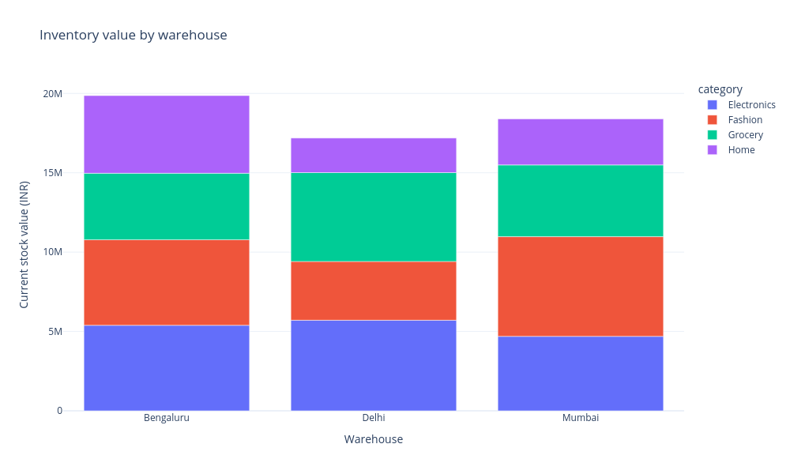
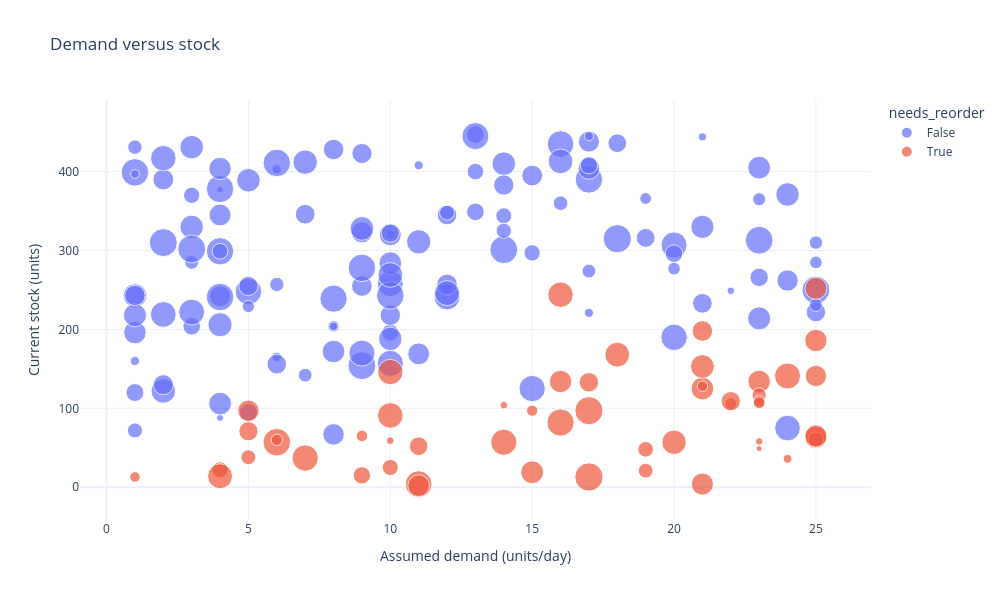
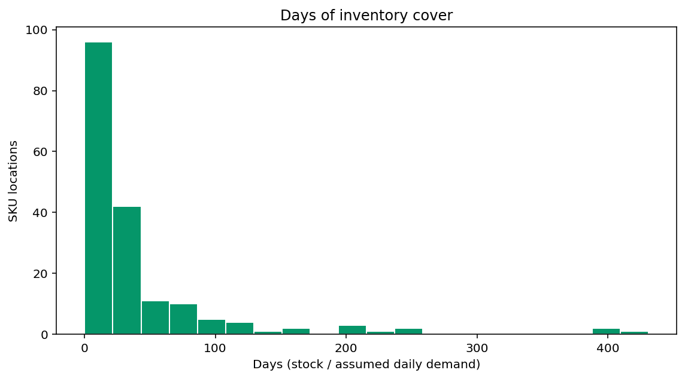
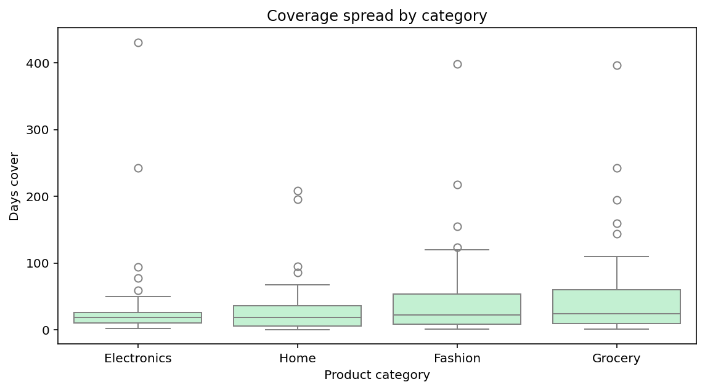
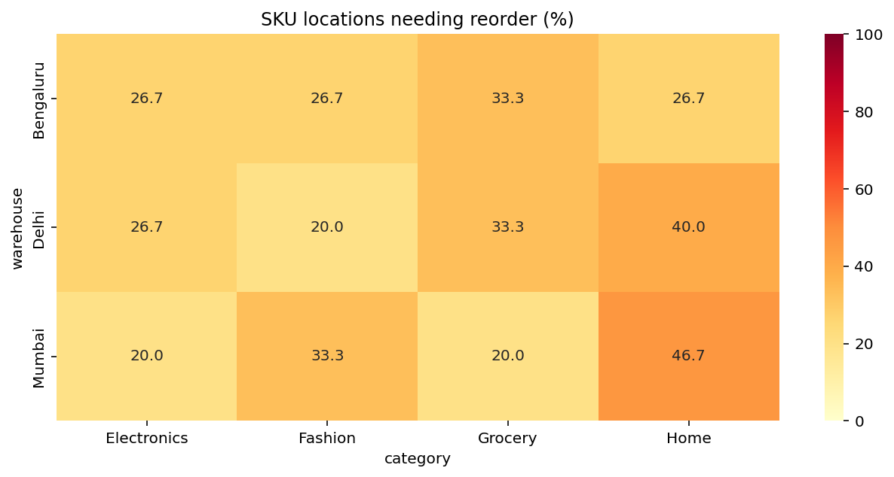

# Inventory Planning Desk - a worked Python and Streamlit tutorial

This tutorial answers an inventory question with a **commented Python cell**, shows its **executed output**, and explains why that calculation is useful. It uses [inventory.csv](inventory.csv) and the calculations in [app.py](app.py), examined at [revision c10a61c36fffdd048b69dd78926e6663bc986fce](https://github.com/cookieSensei/programming-and-ai/blob/c10a61c36fffdd048b69dd78926e6663bc986fce/business_analytics_workshop/04_inventory_planning/app.py).

The 180 records describe **fictional teaching inventory**. Printed outputs and chart images below were generated by executing the displayed cells against the bundled CSV. The example is a deterministic planning scenario, not a live stock ledger or purchasing system.

## How to use the cells

Markdown displays code and results but does not execute them. Run the analysis cells **in order in a single Jupyter notebook session** whose working directory is this folder. Later cells reuse earlier variables. Start where `inventory.csv` is present. A final expression `fig` displays a figure in a notebook; this guide shows the actual generated figure as a PNG.

The last **Streamlit-only cell** is independent and has its own imports and loading. Save it as `practice_inventory_app.py` beside the CSV and run it with Streamlit. It is a compact reconstruction of the interface. The original `app.py` also includes extensive business context, chart explanations, a field dictionary and a twelve-section report.

Use Python 3.12 and the versions in the [workshop instructions](../README.md):

```bash
python -m venv .venv
source .venv/bin/activate
python -m pip install streamlit==1.50.0 pandas==2.2.3 numpy==2.3.5 matplotlib==3.10.8 seaborn==0.13.2 plotly==6.5.2
```

Use a Python 3.12 interpreter for environment creation. On Windows, follow the repository's [WSL guidance](../../README.md) for a full checkout, since other phase-folder names contain `>`. A notebook interface such as the Cloud Lab's JupyterLab is separate from the listed analysis packages.

## 1. What problem are we solving?

An operations team must balance stock availability with money held in products. A warehouse can hold substantial total stock value while one specific item is close to running out. The analysis therefore works at **one SKU in one warehouse**, estimates stock cover and calculates a proposed top-up under a stated rule.

A **SKU** is a stock keeping unit, a product identifier. The same SKU can appear in Delhi, Mumbai and Bengaluru. The pair `(sku, warehouse)` identifies the record. Stock in one location is not assumed to be instantly available in another.

| Field | Meaning and unit |
| --- | --- |
| `sku` | Product identifier |
| `warehouse` | Stock location |
| `category` | Product group |
| `stock_on_hand` | Current units in that location |
| `daily_demand` | Assumed units/day, not a fitted forecast |
| `lead_time_days` | Assumed supplier lead time, in days |
| `safety_stock` | Baseline safety stock, in units |
| `unit_cost` | INR per unit |

The main rule is:

**Threshold = daily demand × (lead time + extra buffer days) + safety stock.**

**Suggested units = maximum of threshold minus current units, and zero.**

The app asks what this rule implies. It does not choose an optimal policy, predict demand from history or place purchase orders. The slider makes an assumption explicit so its quantity and cost consequences can be examined.

Pandas provides tables, Boolean filters, vectorized arithmetic, grouping and exports. Streamlit makes those results usable in a browser. Plotly provides interactive figures; Matplotlib and Seaborn provide distribution and matrix plots. The different tools have separate jobs.

## 2. Load and understand the source

### Cell 01 - Import the tools and locate the inventory file

**Question:** What performs each part of the analysis?

<!-- cell:analysis:01 -->

```python
from pathlib import Path             # Handle paths without machine-specific directories.
import pandas as pd                  # Read, filter and calculate on tables.
import matplotlib.pyplot as plt      # Create figures and axes.
import seaborn as sns                # Draw distributions and a heatmap.
import plotly.express as px           # Build interactive figures from DataFrames.

DATA_FILE = Path("inventory.csv")     # These notebook cells run in this project folder.
print("CSV found:", DATA_FILE.is_file())
print("pandas version:", pd.__version__)
```

**Output**

```text
CSV found: True
pandas version: 2.2.3
```

**Interpretation and reasoning**

The aliases are short module names. A relative `Path` works because the notebook directory is specified. In a saved script, the original app uses `Path(__file__).resolve().with_name(...)` so the CSV is found beside that script even if the launch directory differs. Pandas does the calculations; it does not itself create the browser app.

### Cell 02 - Load the file and inspect five stock records

**Question:** What does one inventory record contain?

<!-- cell:analysis:02 -->

```python
frame = pd.read_csv(DATA_FILE)  # Parse CSV text into a DataFrame with named columns.
print("Source rows:", len(frame))
print("Source columns:", len(frame.columns))
print(frame.head(5).to_string(index=False))
```

**Output**

```text
Source rows: 180
Source columns: 8
    sku warehouse    category  stock_on_hand  daily_demand  lead_time_days  safety_stock  unit_cost
SKU-001     Delhi Electronics            316            19              12            27       1103
SKU-002     Delhi        Home            310            25               3            19        565
SKU-003     Delhi     Fashion            120             1               8            38       1008
SKU-004     Delhi     Grocery            315            18               5            31       2482
SKU-005     Delhi Electronics            248             5               4            31       2197
```

**Interpretation and reasoning**

One row contains a product at a location, not the product's global stock or one purchase order. The first row describes SKU-001 at Delhi with 316 units, assumed demand of 19 units/day, a 12-day lead time, 27 safety units and unit cost INR 1,103.

### Cell 03 - Check data types and the row identity

**Question:** Why are 180 rows not the same as 180 different products?

<!-- cell:analysis:03 -->

```python
# A repeated SKU is valid across warehouses; the SKU-warehouse pair identifies a location.
print(frame.dtypes.astype(str).rename("dtype").to_string())
print()
print("SKU-location rows:", len(frame))
print("Distinct SKU codes:", frame["sku"].nunique())
print("Distinct warehouses:", frame["warehouse"].nunique())
print("Repeated SKU-warehouse pairs:", frame.duplicated(["sku", "warehouse"]).sum())
print()
print(frame.groupby("warehouse").size().rename("locations").to_string())
```

**Output**

```text
sku               object
warehouse         object
category          object
stock_on_hand      int64
daily_demand       int64
lead_time_days     int64
safety_stock       int64
unit_cost          int64

SKU-location rows: 180
Distinct SKU codes: 60
Distinct warehouses: 3
Repeated SKU-warehouse pairs: 0

warehouse
Bengaluru    60
Delhi        60
Mumbai       60
```

**Interpretation and reasoning**

There are 60 SKUs, each in three warehouses. Repeated SKU codes are legitimate, while repeated SKU-warehouse pairs require inspection. The uniqueness check here is an added teaching check; the original app reports exact duplicate rows but does not enforce the composite key. Counting records measures SKU locations, whereas `nunique()` counts distinct labels.

### Cell 04 - Apply the original loader's structural checks

**Question:** Is the table structurally usable without silently dropping rows?

<!-- cell:analysis:04 -->

```python
required_columns = [
    "sku", "warehouse", "category", "stock_on_hand",
    "daily_demand", "lead_time_days", "safety_stock", "unit_cost",
]
numeric_columns = [
    "stock_on_hand", "daily_demand", "lead_time_days", "safety_stock", "unit_cost",
]

if not set(required_columns).issubset(frame.columns):
    raise ValueError("The CSV is missing required columns.")
if frame.empty:
    raise ValueError("The CSV contains no rows.")

for column in numeric_columns:
    # Reject numeric fields containing unparseable text.
    frame[column] = pd.to_numeric(frame[column], errors="raise")

if frame[required_columns].isna().any().any():
    raise ValueError("Fill missing values in the required analysis columns first.")

print("Required-column, nonempty and numeric checks passed.")
print("Missing source cells:", frame.isna().sum().sum())
print("Exact duplicate source rows:", frame.duplicated().sum())
```

**Output**

```text
Required-column, nonempty and numeric checks passed.
Missing source cells: 0
Exact duplicate source rows: 0
```

**Interpretation and reasoning**

The two any() calls reduce missingness first within each column and then across columns. These checks do not remove duplicate records or validate negative numbers, integer quantities or finite values. In the app, specified loading errors become browser messages followed by `st.stop()`, which ends the current run rather than shutting down the server.

### Cell 05 - Reproduce the default warehouse and category filters

**Question:** Which observations contribute to the scenario?

<!-- cell:analysis:05 -->

```python
selected_warehouses = sorted(frame["warehouse"].unique())
selected_categories = sorted(frame["category"].unique())

filtered = frame.copy()  # Preserve source rows for source-quality reporting.
filtered = filtered[filtered["warehouse"].isin(selected_warehouses)]
filtered = filtered[filtered["category"].isin(selected_categories)]
if filtered.empty:
    raise ValueError("No rows match these selections.")

print("Warehouses:", ", ".join(selected_warehouses))
print("Categories:", ", ".join(selected_categories))
print(f"Selected SKU locations: {len(filtered)} of {len(frame)}")
```

**Output**

```text
Warehouses: Bengaluru, Delhi, Mumbai
Categories: Electronics, Fashion, Grocery, Home
Selected SKU locations: 180 of 180
```

**Interpretation and reasoning**

`isin(...)` produces a Boolean decision for each row. Applying both masks keeps records meeting both conditions. The app's widgets supply these chosen lists. All categories and warehouses are selected initially. There is no date filter because this is a stock snapshot.

## 3. Derive the measures with units and business meaning

Multiplying units/day by days gives units. Multiplying units by INR/unit gives INR. Dividing units by units/day gives days. Those unit checks explain why the following formulas are sensible before considering Python syntax.

Vectorized arithmetic applies each expression to aligned rows. It multiplies each row's demand by that row's lead time, not a grand total of demand by a grand total of lead time.

### Cell 06 - Calculate one record by hand in executable code

**Question:** What exactly changes when the extra buffer increases?

<!-- cell:analysis:06 -->

```python
one = filtered.iloc[0]  # The first row by position: SKU-001 at Delhi.

point_zero = one["daily_demand"] * one["lead_time_days"] + one["safety_stock"]
point_seven = one["daily_demand"] * (one["lead_time_days"] + 7) + one["safety_stock"]
units_zero = max(point_zero - one["stock_on_hand"], 0)
units_seven = max(point_seven - one["stock_on_hand"], 0)

print(f"Record: {one['sku']} at {one['warehouse']}")
print(f"Stock value: {one['stock_on_hand']} x {one['unit_cost']} = INR {one['stock_on_hand'] * one['unit_cost']:,.0f}")
print(f"Threshold with 0 extra days: {point_zero} units")
print(f"Threshold with 7 extra days: {point_seven} units")
print(f"Suggested units with 0 extra days: {units_zero}")
print(f"Suggested units with 7 extra days: {units_seven}")
print(f"Cost of the 7-day top-up: INR {units_seven * one['unit_cost']:,.0f}")
print(f"Current cover: {one['stock_on_hand'] / one['daily_demand']:.4f} days")
```

**Output**

```text
Record: SKU-001 at Delhi
Stock value: 316 x 1103 = INR 348,548
Threshold with 0 extra days: 255 units
Threshold with 7 extra days: 388 units
Suggested units with 0 extra days: 0
Suggested units with 7 extra days: 72
Cost of the 7-day top-up: INR 79,416
Current cover: 16.6316 days
```

**Interpretation and reasoning**

Baseline safety stock is already measured in units; the extra buffer is measured in days and must first be multiplied by daily demand. At zero buffer, stock exceeds the threshold, so a negative gap becomes zero. At seven days, the threshold rises above stock and the rule suggests 72 units. Current stock value and days cover stay unchanged because neither observed stock nor assumed demand changed.

### Cell 07 - Calculate the five derived columns for every selected row

**Question:** How does one row's arithmetic scale to the whole table?

<!-- cell:analysis:07 -->

```python
buffer = 0  # Reproduce the source app's default slider value, in extra days.

filtered["reorder_point"] = (
    filtered["daily_demand"] * (filtered["lead_time_days"] + buffer)
    + filtered["safety_stock"]
)
filtered["reorder_units"] = (
    filtered["reorder_point"] - filtered["stock_on_hand"]
).clip(lower=0)  # Do not suggest a negative purchase.

filtered["inventory_value"] = filtered["stock_on_hand"] * filtered["unit_cost"]
filtered["days_cover"] = filtered["stock_on_hand"].div(
    filtered["daily_demand"].replace(0, float("nan"))  # Zero demand makes cover undefined.
)
filtered["needs_reorder"] = filtered["reorder_units"] > 0  # A Boolean flag for each record.

print(
    filtered[["sku", "warehouse", "stock_on_hand", "reorder_point",
              "reorder_units", "days_cover", "needs_reorder"]]
    .head(5).round(2).to_string(index=False)
)
```

**Output**

```text
    sku warehouse  stock_on_hand  reorder_point  reorder_units  days_cover  needs_reorder
SKU-001     Delhi            316            255              0       16.63          False
SKU-002     Delhi            310             94              0       12.40          False
SKU-003     Delhi            120             46              0      120.00          False
SKU-004     Delhi            315            121              0       17.50          False
SKU-005     Delhi            248             51              0       49.60          False
```

**Interpretation and reasoning**

Each `Series` operation applies to matching rows. `clip(lower=0)` implements a top-up-only rule; it does not recommend transfers or stock disposal. The threshold serves as both trigger and target here, whereas more elaborate inventory policies can use separate thresholds and order-up-to targets. No automatic pack-size rounding is applied.

### Cell 08 - Calculate stock value and proposed purchase KPIs

**Question:** What does the selected rule propose overall?

<!-- cell:analysis:08 -->

```python
stock_value = filtered["inventory_value"].sum()
reorder_locations = int(filtered["needs_reorder"].sum())  # True contributes 1; False contributes 0.
suggested_units = filtered["reorder_units"].sum()
purchase = (filtered["reorder_units"] * filtered["unit_cost"]).sum()

print(f"Stock value: INR {stock_value:,.0f}")
print(f"Locations needing reorder: {reorder_locations}")
print(f"Suggested units: {suggested_units:,.0f}")
print(f"Estimated purchase: INR {purchase:,.0f}")
print(f"Extra safety buffer: {buffer} days")
```

**Output**

```text
Stock value: INR 55,448,799
Locations needing reorder: 53
Suggested units: 5,065
Estimated purchase: INR 5,866,261
Extra safety buffer: 0 days
```

**Interpretation and reasoning**

Cost each row's proposed quantity before adding, because products have different costs. Multiplying total units by an unweighted mean cost would generally be wrong. Current stock value is a cost valuation, not retail revenue or available cash. Estimated purchase excludes shipping, discounts and other procurement constraints; no order is placed.

### Cell 09 - Separate stockouts from replenishment flags

**Question:** Why can replenishment be suggested when no location is out of stock?

<!-- cell:analysis:09 -->

```python
# Zero stock is a current condition; a positive top-up flags stock below the scenario threshold.
stockouts = int((filtered["stock_on_hand"] == 0).sum())
positive_stock_reorders = int(
    ((filtered["stock_on_hand"] > 0) & filtered["needs_reorder"]).sum()
)

print("Current zero-stock locations:", stockouts)
print("Locations below the chosen threshold:", reorder_locations)
print("Flagged locations that still have positive stock:", positive_stock_reorders)
```

**Output**

```text
Current zero-stock locations: 0
Locations below the chosen threshold: 53
Flagged locations that still have positive stock: 53
```

**Interpretation and reasoning**

Zero stock and stock below a lead-time threshold are different conditions. The file has no zero-stock records, yet the rule flags 53 locations for replenishment before they necessarily reach zero. The flag is not a probability of stockout.

### Cell 10 - Locate current stock value and calculate warehouse shares

**Question:** Where is the cost value of inventory concentrated?

<!-- cell:analysis:10 -->

```python
def ratio(numerator, denominator):
    # Same scalar fallback as the source app; a zero denominator is still undefined analytically.
    return numerator / denominator if denominator else 0.0

value_by_warehouse = filtered.groupby("warehouse")["inventory_value"].sum()
warehouse_table = value_by_warehouse.rename("stock_value").to_frame()
warehouse_table["share_pct"] = warehouse_table["stock_value"] / stock_value * 100

print(warehouse_table.round(2).to_string())
top_warehouse = value_by_warehouse.idxmax()  # Obtain the label of the maximum.
print()
print("Largest stock-value total:", top_warehouse)
print(f"Share of selected value: {ratio(value_by_warehouse[top_warehouse], stock_value):.2%}")
```

**Output**

```text
           stock_value  share_pct
warehouse
Bengaluru     19865405      35.83
Delhi         17190670      31.00
Mumbai        18392724      33.17

Largest stock-value total: Bengaluru
Share of selected value: 35.83%
```

**Interpretation and reasoning**

Group labels become the result's index, so `idxmax` returns a warehouse name. The share divides its value by the selected total, using comparable INR units. A higher cost value does not prove excess stock: demand, unit prices and lead times also matter. If all value were zero, the helper's fallback would avoid an error but would not make a mathematical share defined.

### Cell 11 - Build the same positive-quantity replenishment worklist

**Question:** Which exact records explain the proposed top-up?

<!-- cell:analysis:11 -->

```python
# Keep only flagged rows, show their inputs and gap, and rank by proposed quantity.
worklist = filtered.loc[
    filtered["needs_reorder"],
    ["sku", "warehouse", "stock_on_hand", "reorder_point", "reorder_units"],
].sort_values("reorder_units", ascending=False)

print("Total worklist rows:", len(worklist))
print(worklist.head(8).to_string(index=False))
```

**Output**

```text
Total worklist rows: 53
    sku warehouse  stock_on_hand  reorder_point  reorder_units
SKU-051    Mumbai             65            360            295
SKU-031     Delhi             21            294            273
SKU-059 Bengaluru             57            301            244
SKU-001    Mumbai             49            269            220
SKU-050    Mumbai              4            220            216
SKU-010 Bengaluru            109            324            215
SKU-049    Mumbai             58            265            207
SKU-006 Bengaluru            117            294            177
```

**Interpretation and reasoning**

`loc` selects the True rows and listed columns. Sorting descending places the largest proposed quantity first. This is a row-level worklist, not grouped totals or a ranking by urgency. Equality to the threshold gives zero proposed units and is excluded. The full app's largest-row lookup has no explicit secondary tie-break rule, so tied SKUs are not guaranteed an alphabetical winner.

### Cell 12 - Compare four buffer scenarios on the identical selected records

**Question:** What quantity and cost tradeoff does the buffer imply?

<!-- cell:analysis:12 -->

```python
scenarios = []
for extra_days in [0, 3, 7, 14]:
    # Temporary Series keep the baseline filtered table unchanged.
    scenario_point = (
        filtered["daily_demand"] * (filtered["lead_time_days"] + extra_days)
        + filtered["safety_stock"]
    )
    scenario_units = (scenario_point - filtered["stock_on_hand"]).clip(lower=0)
    scenarios.append({
        "extra_days": extra_days,
        "flagged_locations": int((scenario_units > 0).sum()),
        "suggested_units": int(scenario_units.sum()),
        "estimated_purchase": float((scenario_units * filtered["unit_cost"]).sum()),
    })

scenario_table = pd.DataFrame(scenarios)
scenario_table["extra_cost_vs_zero"] = (
    scenario_table["estimated_purchase"] - scenario_table.loc[0, "estimated_purchase"]
)
print(scenario_table.to_string(
    index=False,
    formatters={
        "estimated_purchase": "{:,.2f}".format,
        "extra_cost_vs_zero": "{:,.2f}".format,
    },
))
print()
print("Main tutorial buffer remains:", buffer)
```

**Output**

```text
 extra_days  flagged_locations  suggested_units estimated_purchase extra_cost_vs_zero
          0                 53             5065       5,866,261.00               0.00
          3                 69             8043       9,800,855.00       3,934,594.00
          7                 87            12996      16,314,861.00      10,448,600.00
         14                112            24486      31,040,854.00      25,174,593.00

Main tutorial buffer remains: 0
```

**Interpretation and reasoning**

This four-scenario table is a teaching comparison; the app shows the chosen scenario and compares its cost with a zero-buffer baseline on the same selected records. Extra cost is not necessarily a straight line in days because a well-stocked location contributes zero until its threshold crosses current stock. With the bundled nonnegative inputs, a higher buffer cannot reduce suggested units. These are modeled consequences, not purchase recommendations.

### Cell 13 - Compare quantity ranking with cost ranking

**Question:** Is the largest number of units necessarily the largest spending proposal?

<!-- cell:analysis:13 -->

```python
# Explicit extension: the shipped worklist ranks quantity, not proposed spending.
ranked = filtered.assign(
    proposed_cost=filtered["reorder_units"] * filtered["unit_cost"]
)
print("Largest quantities:")
print(
    ranked.sort_values("reorder_units", ascending=False)
    [["sku", "warehouse", "reorder_units", "unit_cost", "proposed_cost"]]
    .head(3).to_string(index=False)
)
print()
print("Largest proposed costs:")
print(
    ranked.sort_values("proposed_cost", ascending=False)
    [["sku", "warehouse", "reorder_units", "unit_cost", "proposed_cost"]]
    .head(3).to_string(index=False)
)
```

**Output**

```text
Largest quantities:
    sku warehouse  reorder_units  unit_cost  proposed_cost
SKU-051    Mumbai            295       1528         450760
SKU-031     Delhi            273        680         185640
SKU-059 Bengaluru            244       1862         454328

Largest proposed costs:
    sku warehouse  reorder_units  unit_cost  proposed_cost
SKU-059 Bengaluru            244       1862         454328
SKU-051    Mumbai            295       1528         450760
SKU-050    Mumbai            216       1538         332208
```

**Interpretation and reasoning**

The extra `proposed_cost` column multiplies quantity by each product's cost. The two rankings can differ, so a quantity-ranked worklist must not be described as a cash-priority ranking. Neither ranking incorporates customer commitments, inbound stock or shortage cost.

## 4. Draw the five existing chart types

The figures below are generated from the default zero-extra-buffer selection. Plotly images are static exports of interactive figures; hover and zoom remain available in a live notebook or Streamlit app. Presentation labels make the units explicit without changing the underlying calculations.

### Cell 14 - Plot warehouse value and category composition

**Question:** Which warehouses and categories hold most cost value?

<!-- cell:analysis:14 -->

```python
grouped = filtered.groupby(
    ["warehouse", "category"], as_index=False,
)["inventory_value"].sum()  # One total per warehouse/category pair.

fig = px.bar(
    grouped, x="warehouse", y="inventory_value", color="category",
    title="Inventory value by warehouse",
    labels={"inventory_value": "Current stock value (INR)", "warehouse": "Warehouse"},
)
fig.update_layout(template="plotly_white")
fig
```

**Output**



**Interpretation and reasoning**

Each category is a stacked segment, and total bar height is warehouse value. Grouping before plotting avoids treating each individual stock row as a separate regional total. This chart stays unchanged when only the buffer changes, because that parameter does not change current stock or unit cost.

### Cell 15 - Plot demand and stock with scenario-dependent flags

**Question:** Which individual locations combine demand and stock levels that trigger the rule?

<!-- cell:analysis:15 -->

```python
# Each point is a SKU location; color uses the rule flag while size uses unit cost.
fig = px.scatter(
    filtered, x="daily_demand", y="stock_on_hand",
    color="needs_reorder", size="unit_cost",
    hover_data=["sku", "warehouse", "reorder_point"],
    title="Demand versus stock",
    labels={"daily_demand": "Assumed demand (units/day)", "stock_on_hand": "Current stock (units)"},
)
fig.update_layout(template="plotly_white")
fig
```

**Output**



**Interpretation and reasoning**

One point is one SKU-location pair. Bubble size encodes unit cost, not current total value or proposed spending. A buffer change can alter color without moving the point's coordinates. There is no universal threshold line because lead times and baseline safety stock differ across records, and the color is not a probabilistic forecast.

### Cell 16 - Inspect the distribution of stock cover

**Question:** Are coverage levels similar, or are some locations much longer or shorter?

<!-- cell:analysis:16 -->

```python
fig, ax = plt.subplots(figsize=(8, 4.5))
ax.hist(
    filtered["days_cover"].dropna(),  # Skip undefined cover, not the whole source records.
    bins=20, color="#059669", edgecolor="white",
)
ax.set(
    title="Days of inventory cover",
    xlabel="Days (stock / assumed daily demand)",
    ylabel="SKU locations",
)
fig.tight_layout()
fig
```

**Output**



**Interpretation and reasoning**

Each location contributes one observation regardless of quantity or cost. For this finite dataset, bin boundaries depend on the selected cover values. Long cover does not automatically mean waste: demand assumptions and replenishment lead times need investigation. A zero-demand record would have undefined cover and be excluded from this histogram while remaining available for other calculations.

### Cell 17 - Compare coverage spread across product categories

**Question:** Do categories have different typical cover or different variability?

<!-- cell:analysis:17 -->

```python
# Compare individual days-cover distributions within each product category.
fig, ax = plt.subplots(figsize=(8, 4.5))
sns.boxplot(
    data=filtered, x="category", y="days_cover",
    ax=ax, color="#bbf7d0",
)
ax.set(
    title="Coverage spread by category",
    xlabel="Product category", ylabel="Days cover",
)
fig.tight_layout()
fig
```

**Output**



**Interpretation and reasoning**

The line is median cover, the box is the middle 50%, and default whiskers reach observations within 1.5 interquartile ranges of the box. Separate points are prompts to inspect the underlying demand and stock, not instructions to delete rows. Cover assumes constant demand and may be justified differently by category.

### Cell 18 - Visualize the share of locations needing reorder

**Question:** In which warehouse/category cells is review workload widespread?

<!-- cell:analysis:18 -->

```python
reorder_pct = filtered.pivot_table(
    index="warehouse",
    columns="category",
    values="needs_reorder",
    aggfunc="mean",  # True is 1 and False is 0, so mean is a proportion.
) * 100

print(reorder_pct.round(2).to_string())
fig, ax = plt.subplots(figsize=(9, 4.5))
sns.heatmap(
    reorder_pct, annot=True, fmt=".1f",
    cmap="YlOrRd", vmin=0, vmax=100, ax=ax,
)
ax.set_title("SKU locations needing reorder (%)")
fig.tight_layout()
fig
```

**Output**

```text
category   Electronics  Fashion  Grocery   Home
warehouse
Bengaluru        26.67    26.67    33.33  26.67
Delhi            26.67    20.00    33.33  40.00
Mumbai           20.00    33.33    20.00  46.67
```



**Interpretation and reasoning**

A cell counts locations equally; it does not measure the share of units, cash or customer impact. Fixed 0-100 bounds keep color meanings consistent across buffer scenarios. Use the worklist and proposed-cost figures alongside the percentages. No observations in a cell would mean missing evidence, not a measured zero requirement.

### Cell 19 - Expose the heatmap denominators

**Question:** How many records produced a percentage such as 46.7%?

<!-- cell:analysis:19 -->

```python
# Recover group sizes so every reorder percentage can be interpreted with its denominator.
cell_counts = filtered.groupby(["warehouse", "category"]).size().unstack("category")
print(cell_counts.to_string())
print()

example = filtered[
    (filtered["warehouse"] == "Mumbai") & (filtered["category"] == "Home")
]
print("Mumbai/Home locations:", len(example))
print("Mumbai/Home flagged:", int(example["needs_reorder"].sum()))
print(f"Mumbai/Home share: {example['needs_reorder'].mean():.1%}")
```

**Output**

```text
category   Electronics  Fashion  Grocery  Home
warehouse
Bengaluru           15       15       15    15
Delhi               15       15       15    15
Mumbai              15       15       15    15

Mumbai/Home locations: 15
Mumbai/Home flagged: 7
Mumbai/Home share: 46.7%
```

**Interpretation and reasoning**

The bundled cells each contain 15 locations. Mumbai/Home has seven flagged records, giving 7/15. Equal group size is a property of this teaching file, not a guarantee for future data. This denominator table is an added teaching check; the shipped inventory heatmap does not display it as a separate table.

## 5. Verify a focused decision and build its explanation

The remaining analysis cells show how the selected records can be inspected, described and exported. The focused scenario uses a separate table so the baseline calculations above stay reproducible.

### Cell 20 - Inspect one warehouse and category under a seven-day scenario

**Question:** Can a manager reproduce the rule for a precisely specified scope?

<!-- cell:analysis:20 -->

```python
# Use a separate table for this focused investigation so the tutorial baseline is preserved.
focus = frame[
    frame["warehouse"].isin(["Delhi"])
    & frame["category"].isin(["Electronics"])
].copy()
focus_buffer = 7
focus["reorder_point"] = (
    focus["daily_demand"] * (focus["lead_time_days"] + focus_buffer)
    + focus["safety_stock"]
)
focus["reorder_units"] = (focus["reorder_point"] - focus["stock_on_hand"]).clip(lower=0)

print("Selection: Delhi; Electronics; 7 extra days")
print("Locations:", len(focus))
print("Flagged:", int((focus["reorder_units"] > 0).sum()))
print("Suggested units:", int(focus["reorder_units"].sum()))
print(f"Estimated purchase: INR {(focus['reorder_units'] * focus['unit_cost']).sum():,.2f}")
print(f"Baseline tutorial remains {len(filtered)} locations and {buffer} extra days.")
```

**Output**

```text
Selection: Delhi; Electronics; 7 extra days
Locations: 15
Flagged: 7
Suggested units: 1057
Estimated purchase: INR 1,530,571.00
Baseline tutorial remains 180 locations and 0 extra days.
```

**Interpretation and reasoning**

The scope includes warehouse, category and buffer. Omitting the buffer from a shared result would leave out a material assumption. The separate `focus` variable prevents this investigation from silently changing the baseline charts or exports.

### Cell 21 - Inspect numeric summaries and distinguish source from derived quality

**Question:** Which numerical values and ranges lie behind the charts?

<!-- cell:analysis:21 -->

```python
# Summarize numeric fields, then compare original missing cells with undefined derived cover.
summary = filtered.select_dtypes(include="number").describe().round(2)
print(summary.to_string())
print()
print("Missing cells in original source:", frame.isna().sum().sum())
print("Undefined derived cover values:", filtered["days_cover"].isna().sum())
```

**Output**

```text
       stock_on_hand  daily_demand  lead_time_days  safety_stock  unit_cost  reorder_point  reorder_units  inventory_value  days_cover
count         180.00        180.00          180.00        180.00     180.00         180.00         180.00           180.00      180.00
mean          228.44         12.37            8.26         37.17    1326.23         137.93          28.14        308048.88       41.13
std           128.54          7.55            3.95         15.28     699.71          77.56          58.58        249193.79       66.33
min             2.00          1.00            2.00         10.00     109.00          30.00           0.00          2932.00        0.18
25%           119.25          5.75            5.00         22.75     704.50          73.25           0.00         96725.75        8.75
50%           241.00         11.00            8.50         37.50    1363.50         121.50           0.00        267189.00       20.39
75%           328.50         19.00           12.00         51.00    1902.75         181.25          28.75        481848.50       36.03
max           447.00         25.00           14.00         60.00    2500.00         360.00         295.00       1014155.00      431.00

Missing cells in original source: 0
Undefined derived cover values: 0
```

**Interpretation and reasoning**

The numeric selection excludes the Boolean `needs_reorder` flag; its True count is already shown in a KPI. `describe()` gives counts, averages, sample standard deviations, quartiles and extrema. The original source-quality display uses `frame`, so an edited zero-demand row could create missing derived cover even while source missing-cell count remained zero.

### Cell 22 - Build scope and answer sentences from calculated values

**Question:** How does the app connect a business question with its measured answer?

<!-- cell:analysis:22 -->

```python
scope_parts = []
for column in frame.select_dtypes(include="object").columns:
    if frame[column].nunique() <= 12:  # Avoid listing all 60 SKU identifiers.
        values = ", ".join(map(str, sorted(filtered[column].unique())))
        scope_parts.append(column.replace("_", " ") + ": " + values)
scope = "; ".join(scope_parts) + f"; extra safety buffer: {buffer} days"

insights = [
    (
        "What stock is represented?",
        f"{len(filtered)} SKU locations, {filtered['sku'].nunique()} distinct SKUs, "
        f"INR {stock_value:,.2f} at cost.",
    ),
    (
        "What top-up does the rule suggest?",
        f"{suggested_units:,.0f} units across {reorder_locations} locations, "
        f"estimated cost INR {purchase:,.2f}.",
    ),
    ("How many locations have zero stock?", str(stockouts)),
]
print("Scope:", scope)
for question, answer in insights:
    print(question)
    print(answer)
```

**Output**

```text
Scope: warehouse: Bengaluru, Delhi, Mumbai; category: Electronics, Fashion, Grocery, Home; extra safety buffer: 0 days
What stock is represented?
180 SKU locations, 60 distinct SKUs, INR 55,448,799.00 at cost.
What top-up does the rule suggest?
5,065 units across 53 locations, estimated cost INR 5,866,261.00.
How many locations have zero stock?
0
```

**Interpretation and reasoning**

The text comes from variables and f-strings, not an external AI model. Low-cardinality text fields describe the selection, and the buffer is explicitly appended. These sentences distinguish location counts from unique SKUs, current value from proposed cost, and zero stock from a reorder flag.

### Cell 23 - Create a compact Markdown report from the same results

**Question:** How can an analysis become a readable file without duplicating calculations?

<!-- cell:analysis:23 -->

```python
# This is a small teaching reconstruction; the original app assembles twelve sections.
kpi_values = [
    ("Stock value", f"INR {stock_value:,.2f}"),
    ("Locations flagged", str(reorder_locations)),
    ("Suggested units", f"{suggested_units:,.0f}"),
    ("Estimated purchase", f"INR {purchase:,.2f}"),
    ("Extra buffer days", str(buffer)),
]
report_parts = [
    "# Inventory - tutorial report",
    "## Scope\n" + scope,
    "## Results\n| Measure | Value |\n| --- | --- |\n"
    + "\n".join(f"| {name} | {value} |" for name, value in kpi_values),
    "## Questions\n"
    + "\n\n".join(f"### {question}\n{answer}" for question, answer in insights),
    "## Limit\nDemand and lead time are assumed fixed. Incoming orders are not modeled. No purchase is placed.",
]
teaching_report = "\n\n".join(report_parts)
print(teaching_report)
```

**Output**

```text
# Inventory - tutorial report

## Scope
warehouse: Bengaluru, Delhi, Mumbai; category: Electronics, Fashion, Grocery, Home; extra safety buffer: 0 days

## Results
| Measure | Value |
| --- | --- |
| Stock value | INR 55,448,799.00 |
| Locations flagged | 53 |
| Suggested units | 5,065 |
| Estimated purchase | INR 5,866,261.00 |
| Extra buffer days | 0 |

## Questions
### What stock is represented?
180 SKU locations, 60 distinct SKUs, INR 55,448,799.00 at cost.

### What top-up does the rule suggest?
5,065 units across 53 locations, estimated cost INR 5,866,261.00.

### How many locations have zero stock?
0

## Limit
Demand and lead time are assumed fixed. Incoming orders are not modeled. No purchase is placed.
```

**Interpretation and reasoning**

`join` combines strings in a deliberate order, and each f-string inserts current values. One report string can be displayed and offered as a download. In the original app, `report_parts[5]` is the KPI section because the report title occupies index 0; that is where its field dictionary is appended. The full report additionally describes methods, five visuals, source quality and limits.

### Cell 24 - Preview the analytical CSV download

**Question:** Which evidence is available behind a shared scenario?

<!-- cell:analysis:24 -->

```python
csv_text = filtered.to_csv(index=False)  # Include fields, not the pandas row index.
print("\n".join(csv_text.splitlines()[:4]))
print()
print("Exported data rows:", len(csv_text.splitlines()) - 1)
print("Exported columns:", ", ".join(filtered.columns))
```

**Output**

```text
sku,warehouse,category,stock_on_hand,daily_demand,lead_time_days,safety_stock,unit_cost,reorder_point,reorder_units,inventory_value,days_cover,needs_reorder
SKU-001,Delhi,Electronics,316,19,12,27,1103,255,0,348548,16.63157894736842,False
SKU-002,Delhi,Home,310,25,3,19,565,94,0,175150,12.4,False
SKU-003,Delhi,Fashion,120,1,8,38,1008,46,0,120960,120.0,False

Exported data rows: 180
Exported columns: sku, warehouse, category, stock_on_hand, daily_demand, lead_time_days, safety_stock, unit_cost, reorder_point, reorder_units, inventory_value, days_cover, needs_reorder
```

**Interpretation and reasoning**

The CSV includes the source fields plus all five derived columns for the selected buffer. This cell creates a string; it does not overwrite inventory.csv. The app provides that string through a download button. A downloaded result does not automatically add the proposed units to current stock.

### Cell 25 - Demonstrate zero-demand handling on a separate practice copy

**Question:** Are undefined cover and a fallback percentage the same thing?

<!-- cell:analysis:25 -->

```python
# Intentionally modify a copy, not the source CSV or the baseline filtered table.
zero_example = frame.head(2).copy()
zero_example.loc[zero_example.index[0], "daily_demand"] = 0

zero_example["days_cover"] = zero_example["stock_on_hand"].div(
    zero_example["daily_demand"].replace(0, float("nan"))
)
zero_example["inventory_value"] = zero_example["stock_on_hand"] * zero_example["unit_cost"]
zero_point = (
    zero_example["daily_demand"] * zero_example["lead_time_days"]
    + zero_example["safety_stock"]
)
zero_example["needs_reorder"] = (zero_point - zero_example["stock_on_hand"]).clip(lower=0) > 0

print(
    zero_example[["sku", "stock_on_hand", "daily_demand",
                  "days_cover", "inventory_value", "needs_reorder"]]
    .round(2).to_string(index=False)
)
print("Defined cover values:", zero_example["days_cover"].dropna().size)
print("Scalar ratio(10, 0) fallback:", ratio(10, 0))
print("Zero-demand rows in the unchanged source:", int((frame["daily_demand"] == 0).sum()))
```

**Output**

```text
    sku  stock_on_hand  daily_demand  days_cover  inventory_value  needs_reorder
SKU-001            316             0         NaN           348548          False
SKU-002            310            25        12.4           175150          False
Defined cover values: 1
Scalar ratio(10, 0) fallback: 0.0
Zero-demand rows in the unchanged source: 0
```

**Interpretation and reasoning**

They use different mechanisms. Zero demand becomes NaN before cover division, and the histogram drops that missing cover. The record still has stock value and a threshold based on safety stock. The scalar ratio helper instead returns 0.0 for a zero denominator to prevent an error; that fallback is not a mathematical definition of an undefined ratio.

### Cell 26 - Add explicit domain checks as a separate improvement

**Question:** What else should be checked before using a new inventory file?

<!-- cell:analysis:26 -->

```python
# These business-domain checks are additional to the original app's numeric parsing checks.
domain_checks = pd.Series({
    "SKU-warehouse pairs are unique": not frame.duplicated(["sku", "warehouse"]).any(),
    "Stock is nonnegative": frame["stock_on_hand"].ge(0).all(),
    "Demand is nonnegative": frame["daily_demand"].ge(0).all(),
    "Lead time is nonnegative": frame["lead_time_days"].ge(0).all(),
    "Safety stock is nonnegative": frame["safety_stock"].ge(0).all(),
    "Unit cost is nonnegative": frame["unit_cost"].ge(0).all(),
    "Stock units are whole numbers": frame["stock_on_hand"].mod(1).eq(0).all(),
})
print(domain_checks.to_string())
```

**Output**

```text
SKU-warehouse pairs are unique    True
Stock is nonnegative              True
Demand is nonnegative             True
Lead time is nonnegative          True
Safety stock is nonnegative       True
Unit cost is nonnegative          True
Stock units are whole numbers     True
```

**Interpretation and reasoning**

These additional checks pass for the bundled file but are not all enforced by the original loader. Negative demand can break expected scenario behavior; negative cost can make spending meaningless and conflict with marker-size plotting. Finite values, pack sizes, valid categories and accuracy need additional checks too. The original app does not round proposed quantities to case packs merely because its cards show zero decimal places.

## 6. Assemble a complete Streamlit teaching app

The next cell is **Streamlit-only**, independent of the notebook namespace. Save it as `practice_inventory_app.py` beside `inventory.csv` and run:

```bash
streamlit run practice_inventory_app.py
```

Use `--server.port 8502` for a separate instance when the workshop dashboard already uses port 8501, and open the forwarded port.

This compact reconstruction includes the scenario slider, filters, four KPIs, five charts, positive-gap worklist, record export and a short report. The original `app.py` additionally contains the complete business narrative, field dictionary, per-chart guides and twelve-section report.

The displayed summary underneath is captured from executing this exact cell with Streamlit AppTest. It describes rendered interface elements, not fictional stdout or a browser screenshot.

### Cell 27 - Build the interactive inventory planning interface

<!-- cell:streamlit:27 -->

```python
from pathlib import Path
import pandas as pd
import plotly.express as px
import matplotlib.pyplot as plt
import seaborn as sns
import streamlit as st

st.set_page_config(page_title="Inventory planning - tutorial", layout="wide")
st.title("Inventory planning - tutorial")
st.caption("Fictional SKU-location snapshot; amounts are INR.")

data_file = Path(__file__).resolve().with_name("inventory.csv")
required = [
    "sku", "warehouse", "category", "stock_on_hand",
    "daily_demand", "lead_time_days", "safety_stock", "unit_cost",
]
numeric = ["stock_on_hand", "daily_demand", "lead_time_days", "safety_stock", "unit_cost"]
try:
    frame = pd.read_csv(data_file)
    if not set(required).issubset(frame.columns) or frame.empty:
        raise ValueError("Supply a nonempty CSV with the required columns.")
    for column in numeric:
        frame[column] = pd.to_numeric(frame[column], errors="raise")
    if frame[required].isna().any().any():
        raise ValueError("Fill missing required values.")
except (OSError, ValueError, KeyError) as error:
    st.error(str(error))
    st.stop()  # End this run while keeping the app available for correction.

warehouses = st.sidebar.multiselect(
    "Warehouses", sorted(frame["warehouse"].unique()),
    default=sorted(frame["warehouse"].unique()), key="inventory_demo_warehouses",
)
categories = st.sidebar.multiselect(
    "Categories", sorted(frame["category"].unique()),
    default=sorted(frame["category"].unique()), key="inventory_demo_categories",
)
filtered = frame[
    frame["warehouse"].isin(warehouses) & frame["category"].isin(categories)
].copy()
if filtered.empty:
    st.info("Select at least one warehouse and category with matching records.")
    st.stop()

# This scalar widget value participates in every row's threshold formula.
buffer = st.sidebar.slider("Extra safety buffer (days)", 0, 14, 0, key="inventory_demo_buffer")
filtered["reorder_point"] = (
    filtered["daily_demand"] * (filtered["lead_time_days"] + buffer) + filtered["safety_stock"]
)
filtered["reorder_units"] = (filtered["reorder_point"] - filtered["stock_on_hand"]).clip(lower=0)
filtered["inventory_value"] = filtered["stock_on_hand"] * filtered["unit_cost"]
filtered["days_cover"] = filtered["stock_on_hand"].div(
    filtered["daily_demand"].replace(0, float("nan"))
)
filtered["needs_reorder"] = filtered["reorder_units"] > 0
purchase = (filtered["reorder_units"] * filtered["unit_cost"]).sum()

cards = st.columns(4)
cards[0].metric("Stock value (INR)", f"{filtered['inventory_value'].sum():,.0f}")
cards[1].metric("Locations needing reorder", f"{filtered['needs_reorder'].sum():,}")
cards[2].metric("Suggested units", f"{filtered['reorder_units'].sum():,.0f}")
cards[3].metric("Estimated purchase (INR)", f"{purchase:,.0f}")

dashboard, explore, data_tab, report_tab = st.tabs(["Dashboard", "Explore", "Data", "Report"])
with dashboard:
    grouped = filtered.groupby(
        ["warehouse", "category"], as_index=False,
    )["inventory_value"].sum()
    st.plotly_chart(
        px.bar(grouped, x="warehouse", y="inventory_value", color="category",
               title="Inventory value by warehouse"),
        use_container_width=True,
    )
    st.plotly_chart(
        px.scatter(filtered, x="daily_demand", y="stock_on_hand",
                   color="needs_reorder", size="unit_cost",
                   hover_data=["sku", "warehouse", "reorder_point"],
                   title="Demand versus stock"),
        use_container_width=True,
    )
    worklist = filtered.loc[
        filtered["needs_reorder"],
        ["sku", "warehouse", "stock_on_hand", "reorder_point", "reorder_units"],
    ].sort_values("reorder_units", ascending=False)
    st.subheader("Replenishment worklist")
    st.dataframe(worklist, hide_index=True, width="stretch")

with explore:
    fig, ax = plt.subplots(figsize=(7, 4))
    ax.hist(filtered["days_cover"].dropna(), bins=20, color="#059669", edgecolor="white")
    ax.set(xlabel="Days cover", ylabel="SKU locations")
    st.pyplot(fig)
    plt.close(fig)

    fig, ax = plt.subplots(figsize=(7, 4))
    sns.boxplot(data=filtered, x="category", y="days_cover", ax=ax)
    st.pyplot(fig)
    plt.close(fig)

    share = filtered.pivot_table(
        index="warehouse", columns="category", values="needs_reorder", aggfunc="mean",
    ) * 100
    fig, ax = plt.subplots(figsize=(9, 4))
    sns.heatmap(share, annot=True, fmt=".1f", vmin=0, vmax=100, cmap="YlOrRd", ax=ax)
    st.pyplot(fig)
    plt.close(fig)

with data_tab:
    st.dataframe(filtered, hide_index=True, width="stretch")
    st.download_button(
        "Download selected CSV", filtered.to_csv(index=False),
        "tutorial_inventory_selection.csv", "text/csv",
    )

report = (
    "# Inventory scenario summary\n\n"
    f"Selected SKU locations: {len(filtered)}\n\n"
    f"Extra safety days: {buffer}\n\n"
    f"Estimated purchase: INR {purchase:,.2f}\n\n"
    "Demand and lead time are assumed fixed. No purchase is placed."
)
with report_tab:
    st.markdown(report)
    st.download_button("Download short report", report, "tutorial_inventory_report.md", "text/markdown")
```

**Rendered Streamlit output - captured text summary**

This summarizes the interface produced by this complete Streamlit cell with its default selections; it is not terminal stdout or a browser screenshot.

```text
Title: Inventory planning - tutorial
Warehouses: Bengaluru, Delhi, Mumbai
Categories: Electronics, Fashion, Grocery, Home
Extra safety buffer (days): 0
Stock value (INR): 55,448,799
Locations needing reorder: 53
Suggested units: 5,065
Estimated purchase (INR): 5,866,261
Table 1: 53 rows x 5 columns
Table 2: 180 rows x 13 columns
Interactive Plotly charts: 2
Rendered image charts: 3
Download: Download selected CSV
Download: Download short report
```

**Interpretation and reasoning**

Changing a sidebar widget normally reruns the script from the top. The uncached CSV read runs again and all results are rebuilt from selected rows and buffer. Current stock value and days cover do not depend on the buffer, while proposed units, cost and colors do. Tabs organize output but their code still executes in Streamlit 1.50. Hover, zoom and table sorting do not create new analytical filters.

## 7. Relate the tutorial to the original app

The original source stores explanations in `CASE`, `DECISION`, `DATA_CONTEXT`, `FORMULAS`, `VISUAL_GUIDE`, `RECOMMENDATIONS` and `LIMITATIONS`. Its `explain_visual` helper pairs each figure with purpose, reading instructions, a question and a limitation. Those strings explain calculations; they do not make the inventory decisions.

The full source calculates a zero-extra-buffer purchasing baseline for the same filtered records, then reports the incremental cost of the selected buffer. It distinguishes unique SKUs from SKU locations and zero stock from a positive proposed top-up. Its quantity-ranked worklist is row-level despite a generic caption referring to grouped values.

### Current limitations

- Demand is an assumed constant, not a forecast fitted by this app.
- Lead time is fixed, and baseline safety stock is an input rather than an estimated service-level policy.
- Incoming purchase orders, backorders, stock transfers, supplier capacity, expiry, order multiples and procurement discounts are absent.
- The threshold is also used as the proposed top-up target; this is not an optimization of shortage and carrying costs.
- Stock value is current cost value. Purchase cost is hypothetical and does not update stock.
- Source-quality checks use `frame`; derived missing cover belongs to `filtered` and is not counted as a source missing cell.
- The original loader does not enforce nonnegative values, finite numbers, integer units or unique SKU-location keys.
- The warehouse leader uses `idxmax()`, whose ties follow the grouped result order. The largest individual quantity uses `sort_values(...).iloc[0]` without an explicit secondary tie-break rule.
- A higher reorder percentage counts more flagged locations proportionally; it does not necessarily imply more units, spending or urgency.
- Saving a CSV edit is reflected on the next rerun; saving alone does not guarantee an automatic rerun.

### Questions to try next

Change a selection in Cell 5 and rerun the later analysis. Explain why SKU and location counts can differ. Set `buffer` in Cell 7 to seven and rerun all later cells to reproduce that scenario's charts. Add incoming stock in a practice copy, but state when it is assumed to arrive. Add pack-size rounding only after defining the pack-size field and the intended rule. Compare quantity and cost rankings without calling either an optimal purchasing plan.

## References

The project-specific source is [app.py](app.py), [inventory.csv](inventory.csv) and the [workshop setup](../README.md). All printed results and figures above are generated from the displayed cells.

- [pandas 2.2 introduction](https://pandas.pydata.org/pandas-docs/version/2.2/user_guide/10min.html) and [grouping](https://pandas.pydata.org/pandas-docs/version/2.2/user_guide/groupby.html)
- [Streamlit execution](https://docs.streamlit.io/develop/concepts/architecture/run-your-app) and [Streamlit 1.50 tabs](https://docs.streamlit.io/1.50.0/develop/api-reference/layout/st.tabs)
- [Plotly Express](https://plotly.com/python/plotly-express/)
- [Seaborn boxplots](https://seaborn.pydata.org/generated/seaborn.boxplot.html)
- [Matplotlib figure cleanup](https://matplotlib.org/stable/api/_as_gen/matplotlib.pyplot.close.html)
