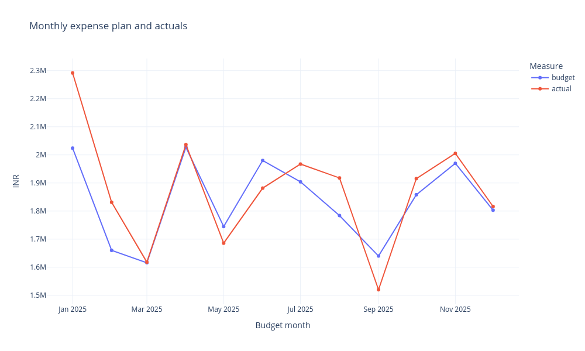
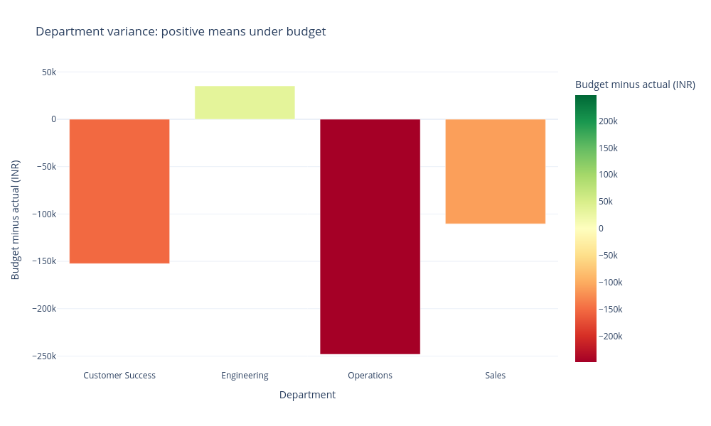
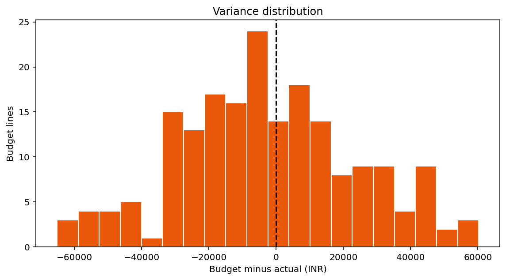
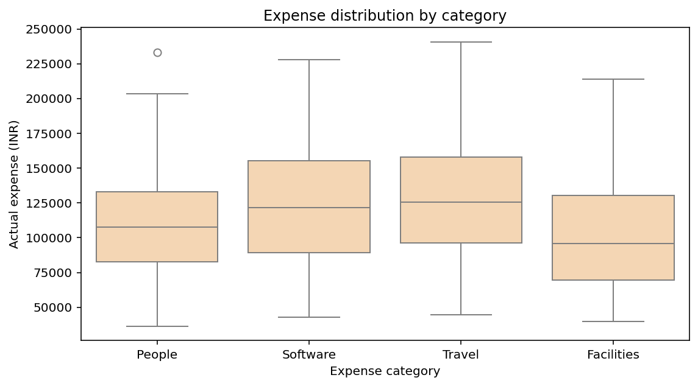
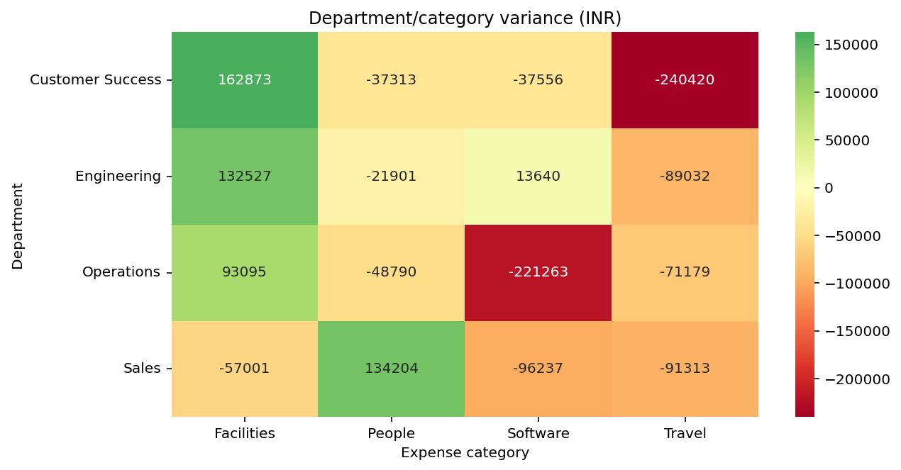

# Budget versus Actuals - an executed Python and Streamlit tutorial

**Run the lesson:** [Open the step-by-step Jupyter notebook](TUTORIAL.ipynb) for executable cells, saved outputs, checkpoints, and practice tasks.

This tutorial starts with a finance manager's questions, works through the [supplied CSV in this folder](department_budget.csv), and finishes with a complete commented Streamlit application. Each analysis cell contains Python you can run, its **actually executed output**, and an explanation of why the operation answers the question. The five chart images and printed outputs were captured from those cells using the supplied data.

**How to use the cells:** Markdown displays static code and recorded results. Open a new notebook or an interactive Python session, set its working directory to this folder, then run the analysis cells in order in one session. Each cell uses variables created earlier. A final bare `fig` displays a figure in a notebook; in a plain Python script use `fig.show()` for Plotly or `plt.show()` for Matplotlib. The final Streamlit cell is a **separate complete script**: save it as `practice_app.py` beside the CSV and launch it with Streamlit. Do not paste it into the middle of the analysis session or overwrite the original `app.py`.

The [existing app](app.py) and dataset match revision [`c10a61c36fffdd048b69dd78926e6663bc986fce`](https://github.com/cookieSensei/programming-and-ai/blob/c10a61c36fffdd048b69dd78926e6663bc986fce/business_analytics_workshop/05_finance_budget/app.py). This guide reorganizes their calculations into teaching cells. Additional diagnostics are labeled as extensions. All records are fictional teaching data, all amounts are INR, and dates label budget months in 2025.

## Learning route

1. [The business question](#the-business-question)
2. [Prepare and inspect the data](#prepare-and-inspect-the-data)
3. [Filter records and calculate the business measures](#filter-records-and-calculate-the-business-measures)
4. [Explain the results through five charts](#explain-the-results-through-five-charts)
5. [Inspect and share the evidence](#inspect-and-share-the-evidence)
6. [Turn the analysis into a Streamlit application](#turn-the-analysis-into-a-streamlit-application)
7. [Understand the original app and its limits](#understand-the-original-app-and-its-limits)
8. [References](#references)

## The business question

A manager needs to know whether recorded expenses exceed the approved plan, which departments or categories explain the gap, and which owners should investigate. A single company total can hide offsetting differences: one line overspends while another remains under budget. Large spending is also different from poor budget adherence; a large department may have a proportionally large approved plan.

This project therefore connects **total amounts, percentage utilization, individual lines, department/month groups, and distributions**. It produces questions for follow-up rather than deciding that an expense was wasteful. The dataset contains no income, commitments, cash timing, or business output, so it cannot calculate profit, available cash, or whether the expense was justified.

One row is one **month/department/expense-category budget line**. It is not one purchase or one employee. The `month` field uses the first day as a label for the whole recorded month; selecting part of a calendar month does not prorate its budget.

| Field | Business meaning |
| --- | --- |
| `month` | Month label, recorded on its first day |
| `department` | Department responsible for the expense |
| `expense_category` | Expense classification |
| `budget` | Planned expense for that line, INR |
| `actual` | Recorded expense for that line, INR |

**Why pandas?** A `DataFrame` stores the CSV as named columns and rows. Its selection, date parsing, grouping, and arithmetic let us express the question directly: group by department, then add planned and recorded expense. Python loops could also do the job; pandas avoids repeatedly implementing table bookkeeping. The analyst still has to choose the correct grain, denominator, and interpretation.

## Prepare and inspect the data

Use Python 3.12 and the versions in the [workshop setup](../README.md). From the repository root in a Linux/macOS terminal:

```bash
python -m venv .venv
source .venv/bin/activate
python -m pip install streamlit==1.50.0 pandas==2.2.3 numpy==2.3.5 matplotlib==3.10.8 seaborn==0.13.2 plotly==6.5.2
cd business_analytics_workshop/05_finance_budget
```

Select this environment as the notebook kernel, or use its Python console. If a notebook tool is not installed, install/use JupyterLab or VS Code's notebook support separately. The prepared CookieSensei workshop workspace already supplies the analysis environment. For a full Windows checkout, follow the [repository README](../../README.md) and use WSL or the Linux Cloud Lab because other phase-folder names contain `>`. The figures below are captured PNGs; creating the same interactive Plotly figures with `fig` does not require an image-export package.

### Cell 01 - Import the tools and locate the CSV

**Question:** Which tools do we need, and have we opened the correct project folder?

<!-- cell:analysis:01 -->

```python
from pathlib import Path             # Build file paths without hard-coding a machine.
import pandas as pd                  # Work with tables, dates, and grouped calculations.
import matplotlib.pyplot as plt      # Create figures/axes and draw a histogram.
import seaborn as sns                # Draw statistical boxes and a matrix heatmap.
import plotly.express as px          # Build interactive line and bar figures.

DATA_FILE = Path('department_budget.csv')  # Notebook cells run from this folder.
print(f'Dataset: {DATA_FILE.name}')
print(f'File exists: {DATA_FILE.is_file()}')
```

**Output**

```text
Dataset: department_budget.csv
File exists: True
```

**Interpretation and reasoning**

The aliases `pd`, `plt`, `sns`, and `px` are short module names. In a notebook, `__file__` is usually unavailable, so this cell uses the stated working directory. The actual app uses `Path(__file__).resolve().with_name(...)` because a saved script has its own filename. pandas handles values; plotting libraries encode them visually. Streamlit is introduced only when we build the browser interface.

### Cell 02 - Load real records and read their meaning

**Question:** What does the input actually contain?

<!-- cell:analysis:02 -->

```python
frame = pd.read_csv(DATA_FILE)         # Parse the CSV header and records into a DataFrame.
print(f'Rows: {len(frame)} | Columns: {len(frame.columns)}')
print(frame.head(4).to_string(index=False))  # Inspect a small real sample, not the whole file.
```

**Output**

```text
Rows: 192 | Columns: 5
     month department expense_category  budget    actual
2025-01-01      Sales           People  112000 131473.15
2025-01-01      Sales         Software   82000 111991.54
2025-01-01      Sales           Travel  172000 119684.36
2025-01-01      Sales       Facilities   56000  59246.32
```

**Interpretation and reasoning**

The first line describes Sales / People for January: INR 112,000 planned and INR 131,473.15 recorded. January 1 is a month label, not proof that the expense was paid that day. `head(4)` is inspection only; it does not replace `frame` with four rows. `index=False` hides pandas row labels in the printed table.

### Cell 03 - Check the grain before counting or aggregating

**Question:** Does each row represent the level of detail we intend to analyze?

<!-- cell:analysis:03 -->

```python
# A business key describes one intended month/department/category combination.
key = ['month', 'department', 'expense_category']
print(f'Month labels: {frame["month"].nunique()}')
print(f'Departments: {frame["department"].nunique()}')
print(f'Expense categories: {frame["expense_category"].nunique()}')
print(f'Repeated business keys: {frame.duplicated(subset=key).sum()}')
print('Departments:', ', '.join(sorted(frame['department'].unique())))
```

**Output**

```text
Month labels: 12
Departments: 4
Expense categories: 4
Repeated business keys: 0
Departments: Customer Success, Engineering, Operations, Sales
```

**Interpretation and reasoning**

Twelve months times four departments times four categories explains the 192 lines. Counting rows measures budget lines, not purchases or employees. The repeated-key calculation is an **additional diagnostic**; the original app counts exact duplicate rows but does not enforce this business key. A repeated key might be a duplicate, a revision, or a legitimate subline; its meaning must be resolved before totals are trusted.

### Cell 04 - Turn date and amount text into usable types

**Question:** Can the computer compare dates and do arithmetic on expenses reliably?

<!-- cell:analysis:04 -->

```python
# Dates become datetime values so comparisons are chronological.
frame['month'] = pd.to_datetime(frame['month'], errors='raise')

# An invalid numeric string raises an error instead of silently becoming a missing value.
numeric_columns = ['budget', 'actual']
for column in numeric_columns:
    frame[column] = pd.to_numeric(frame[column], errors='raise')

print(frame.dtypes.to_string())
print('Observed month labels:', frame['month'].min().date(), 'to', frame['month'].max().date())
```

**Output**

```text
month               datetime64[ns]
department                  object
expense_category            object
budget                       int64
actual                     float64
Observed month labels: 2025-01-01 to 2025-12-01
```

**Interpretation and reasoning**

A column that looks numeric in a spreadsheet can still be text. Explicit parsing makes the intended type clear. `errors="raise"` does not enforce nonnegative, finite, or economically plausible amounts; it addresses parsing. The final date is December 1 because the file represents December with its first-day label.

### Cell 05 - Validate required values and inspect source quality

**Question:** Are essential fields present and filled, and what do the checks actually establish?

<!-- cell:analysis:05 -->

```python
required = ['month', 'department', 'expense_category', 'budget', 'actual']
if not set(required).issubset(frame.columns):  # All required names must be present.
    raise ValueError('The CSV is missing required columns.')
if frame.empty:                              # A header alone is not an analyzable dataset.
    raise ValueError('The CSV contains no rows.')
if frame[required].isna().any().any():         # Reduce missing-cell flags across both axes.
    raise ValueError('Fill missing required values before analysis.')

quality = pd.DataFrame({
    'field': frame.columns,
    'type': frame.dtypes.astype(str).values,
    'missing': frame.isna().sum().values,
})
print(quality.to_string(index=False))
print(f'Exact duplicate rows: {frame.duplicated().sum()}')
```

**Output**

```text
           field           type  missing
           month datetime64[ns]        0
      department         object        0
expense_category         object        0
          budget          int64        0
          actual        float64        0
Exact duplicate rows: 0
```

**Interpretation and reasoning**

The checks match the original app's required-field/nonempty/missing-value policy. As in the app, parsing the month occurs before the required-column test, so a missing month header can raise a `KeyError` first. The app catches loading errors and displays them with `st.error`; this notebook lets the exception stop the cell. Zero missing/duplicate counts do not prove accounting accuracy. No records are automatically dropped or imputed.

## Filter records and calculate the business measures

### Cell 06 - Reproduce the default analytical selection

**Question:** Which exact population do the following totals describe?

<!-- cell:analysis:06 -->

```python
# These variables stand in for sidebar widget choices in the browser app.
selected_departments = sorted(frame['department'].unique())
selected_categories = sorted(frame['expense_category'].unique())
start_date = frame['month'].min().date()
end_date = frame['month'].max().date()

filtered = frame.copy()  # Keep the original table for source-quality reporting.
filtered = filtered[filtered['department'].isin(selected_departments)]
filtered = filtered[filtered['expense_category'].isin(selected_categories)]
filtered = filtered[filtered['month'].dt.date.between(start_date, end_date)]
if filtered.empty:
    raise ValueError('No rows match the chosen selection.')

print(f'Selected {len(filtered)} of {len(frame)} budget lines')
print(f'Inclusive date window: {start_date} to {end_date}')
```

**Output**

```text
Selected 192 of 192 budget lines
Inclusive date window: 2025-01-01 to 2025-12-01
```

**Interpretation and reasoning**

`.isin()` produces a Boolean mask; `filtered[mask]` keeps matching rows. Applying the three conditions sequentially means a row must satisfy all of them. `.between()` includes both endpoints. All values are selected here, so subsequent displayed outputs reproduce the default dashboard. Change the selection deliberately and rerun all later cells to explore another population.

### Cell 07 - See a Boolean filter without changing the main selection

**Question:** How does a text choice become an actual row selection?

<!-- cell:analysis:07 -->

```python
# This separate inspection table does not replace filtered.
operations_mask = frame['department'].isin(['Operations'])
operations = frame[operations_mask]
print('First eight membership flags:', operations_mask.head(8).tolist())
print(f'Operations lines: {len(operations)}')
print(operations.head(3).to_string(index=False))
```

**Output**

```text
First eight membership flags: [False, False, False, False, False, False, False, False]
Operations lines: 48
     month department expense_category  budget    actual
2025-01-01 Operations           People  166000 153352.45
2025-01-01 Operations         Software  141000 172797.34
2025-01-01 Operations           Travel  178000 235846.10
```

**Interpretation and reasoning**

Each flag answers whether one source row belongs to Operations. The mask retains 48 lines: 12 months times four categories. This cell creates a separate `operations` variable so the later all-data examples remain reproducible. In the actual Streamlit app, choosing Operations instead narrows `filtered` and changes every downstream result.

### Cell 08 - Calculate one variance for each budget line

**Question:** Which records are above or below their plan?

<!-- cell:analysis:08 -->

```python
# pandas subtracts corresponding values row by row, preserving the row labels.
filtered['variance'] = filtered['budget'] - filtered['actual']
print(filtered[['month', 'department', 'expense_category', 'budget', 'actual', 'variance']]
      .head(4).to_string(index=False))
```

**Output**

```text
     month department expense_category  budget    actual  variance
2025-01-01      Sales           People  112000 131473.15 -19473.15
2025-01-01      Sales         Software   82000 111991.54 -29991.54
2025-01-01      Sales           Travel  172000 119684.36  52315.64
2025-01-01      Sales       Facilities   56000  59246.32  -3246.32
```

**Interpretation and reasoning**

The first line is `112000 - 131473.15 = -19473.15`: negative variance means overspend. The Travel line is positive because its actual expense is below plan. This project deliberately uses **budget minus actual**; another sign convention would reverse the interpretation. The new column exists only in `filtered`, not in the source CSV or `frame`.

### Cell 09 - Calculate the four dashboard KPIs

**Question:** Is the selected activity within its overall expense plan?

<!-- cell:analysis:09 -->

```python
def ratio(numerator, denominator):  # This is the original app's scalar safeguard.
    return numerator / denominator if denominator else 0.0

budget = filtered['budget'].sum()   # Add planned expenses in the chosen population.
actual = filtered['actual'].sum()   # Add recorded expenses in the same population.
variance = budget - actual
utilization = ratio(actual, budget) # Divide totals, not individual percentage values.

print(f'Budget: INR {budget:,.2f}')
print(f'Actual expense: INR {actual:,.2f}')
print(f'Budget minus actual: INR {variance:,.2f}')
print(f'Budget utilization: {utilization:.2%}')
```

**Output**

```text
Budget: INR 22,011,000.00
Actual expense: INR 22,486,668.08
Budget minus actual: INR -475,668.08
Budget utilization: 102.16%
```

**Interpretation and reasoning**

Actual exceeds the budget by INR 475,668.08; utilization is slightly over 102%. `:.2%` converts the stored ratio to a percentage for display, so do not multiply by 100 before using that formatter. The helper returns a fallback zero for a zero denominator, which prevents a crash but does not make utilization mathematically defined when budget is zero. The bundled budgets are positive. Unspent budget is neither profit nor available cash.

### Cell 10 - Demonstrate why utilization must use the money weights

**Question:** Why not average the utilization percentages of all rows?

<!-- cell:analysis:10 -->

```python
# Compare two different questions using the actual selected budget lines.
line_rates = filtered['actual'].div(filtered['budget'].replace(0, float('nan')))
unweighted_mean = line_rates.mean()              # Each line receives equal influence.
weighted_mean = (line_rates * filtered['budget']).sum() / budget

print(f'Unweighted mean of line utilization: {unweighted_mean:.4%}')
print(f'Budget-weighted mean: {weighted_mean:.4%}')
print(f'Ratio of total actual to total budget: {actual / budget:.4%}')
```

**Output**

```text
Unweighted mean of line utilization: 102.5677%
Budget-weighted mean: 102.1610%
Ratio of total actual to total budget: 102.1610%
```

**Interpretation and reasoning**

This is a diagnostic extension using real source values. An unweighted mean gives a small budget line the same influence as a large one. Weighting by budget gives the same answer as dividing the total actual by the total budget, because the question concerns the money planned for the entire selection. The identity shown here uses this file's positive budgets; zero-budget lines require an explicit policy rather than quietly treating missing rates as valid.

### Cell 11 - Count overspent lines before combining them

**Question:** Is overspending widespread or limited to a few lines?

<!-- cell:analysis:11 -->

```python
overspent_mask = filtered['variance'] < 0       # True means this individual line is overspent.
overspent_lines = int(overspent_mask.sum())     # Summing Booleans counts True values.
print(f'Overspent lines: {overspent_lines} of {len(filtered)}')
print(f'Share of lines overspent: {overspent_lines / len(filtered):.1%}')
print(filtered.loc[overspent_mask, ['department', 'expense_category', 'variance']]
      .head(3).to_string(index=False))
```

**Output**

```text
Overspent lines: 109 of 192
Share of lines overspent: 56.8%
department expense_category  variance
     Sales           People -19473.15
     Sales         Software -29991.54
     Sales       Facilities  -3246.32
```

**Interpretation and reasoning**

109 of 192 lines are overspent, about 56.8%. This is a frequency measure: an INR 100 difference and an INR 50,000 difference each count as one line. It is not the share of expense that is over budget. Counting after departmental grouping would answer a different question: how many department totals are overspent.

### Cell 12 - Separate gross overspending from offsetting underspending

**Question:** Can a modest net gap hide much larger differences underneath?

<!-- cell:analysis:12 -->

```python
# Extension: the existing app reports net variance and counts, not these two extra totals.
gross_overspend = -filtered.loc[filtered['variance'] < 0, 'variance'].sum()
underspend = filtered.loc[filtered['variance'] > 0, 'variance'].sum()
print(f'Overspend on overspent lines: INR {gross_overspend:,.2f}')
print(f'Unspent amount on underspent lines: INR {underspend:,.2f}')
print(f'Net overspend after offsets: INR {gross_overspend - underspend:,.2f}')
```

**Output**

```text
Overspend on overspent lines: INR 2,279,661.72
Unspent amount on underspent lines: INR 1,803,993.64
Net overspend after offsets: INR 475,668.08
```

**Interpretation and reasoning**

The negative variances total more than INR 2.27 million in magnitude, but underspent lines offset more than INR 1.80 million. Subtracting these amounts recovers the same net overspend as the KPI. The leading minus sign converts a sum of negative variances into a positive amount above plan. Filtering before summing preserves the difference between gross and net quantities.

### Cell 13 - Compare department totals and proportional adherence

**Question:** Which departments explain the portfolio gap, and how large is it relative to their plan?

<!-- cell:analysis:13 -->

```python
departments = filtered.groupby('department', as_index=False)[['budget', 'actual', 'variance']].sum()
# Zero-budget groups have an undefined percentage, represented here by NaN.
departments['utilization_pct'] = 100 * departments['actual'].div(
    departments['budget'].replace(0, float('nan'))
)
print(departments.round(2).to_string(index=False))
```

**Output**

```text
      department  budget     actual   variance  utilization_pct
Customer Success 5671000 5823416.49 -152416.49           102.69
     Engineering 5151000 5115766.06   35233.94            99.32
      Operations 5840000 6088137.19 -248137.19           104.25
           Sales 5349000 5459348.34 -110348.34           102.06
```

**Interpretation and reasoning**

Grouping changes the grain from budget lines to departments. `as_index=False` keeps department names as a normal column for Plotly. Operations has the most negative total, while Engineering is under budget. Compare INR variance with utilization because department scale matters. This grouped-rate approach leaves zero-budget rates missing, unlike the scalar helper's fallback zero.

### Cell 14 - Retrieve the record behind the largest individual overspend

**Question:** Does the worst department total necessarily contain the single largest overrun?

<!-- cell:analysis:14 -->

```python
# idxmin returns the row's index label; loc retrieves the whole matching record.
largest_line = filtered.loc[filtered['variance'].idxmin()]
dept_totals = filtered.groupby('department')['variance'].sum()
lowest_department = dept_totals.idxmin()

print(f'Lowest department variance: {lowest_department} / INR {dept_totals[lowest_department]:,.2f}')
print(f'Largest individual line: {largest_line["department"]} / {largest_line["expense_category"]}')
print(f'Month: {largest_line["month"]:%Y-%m}')
print(f'Budget: INR {largest_line["budget"]:,.2f} | Actual: INR {largest_line["actual"]:,.2f}')
print(f'Amount above plan: INR {-largest_line["variance"]:,.2f}')
```

**Output**

```text
Lowest department variance: Operations / INR -248,137.19
Largest individual line: Customer Success / Travel
Month: 2025-02
Budget: INR 165,000.00 | Actual: INR 230,141.08
Amount above plan: INR 65,141.08
```

**Interpretation and reasoning**

Operations has the lowest department total, while Customer Success / Travel in February is the most negative individual line. Both statements are correct because they refer to different grains. This sample has overspent lines; the original app additionally checks that the minimum is negative before calling it an overspend. Tied row minima return the first matching source row, while grouped ties follow group ordering.

### Cell 15 - Aggregate by month and count over-plan months

**Question:** How does adherence vary over the recorded budget months?

<!-- cell:analysis:15 -->

```python
# Combine selected departments/categories within each recorded month before comparing totals.
monthly = filtered.groupby('month', as_index=False)[['budget', 'actual', 'variance']].sum()
print(monthly.round(2).to_string(index=False))
print(f'Months above plan: {(monthly["variance"] < 0).sum()} of {len(monthly)}')
```

**Output**

```text
     month  budget     actual   variance
2025-01-01 2024000 2291618.34 -267618.34
2025-02-01 1660000 1831126.51 -171126.51
2025-03-01 1616000 1618027.34   -2027.34
2025-04-01 2027000 2036532.33   -9532.33
2025-05-01 1745000 1685619.45   59380.55
2025-06-01 1980000 1881700.62   98299.38
2025-07-01 1904000 1967301.41  -63301.41
2025-08-01 1784000 1917893.79 -133893.79
2025-09-01 1640000 1519885.03  120114.97
2025-10-01 1858000 1915542.47  -57542.47
2025-11-01 1970000 2005312.18  -35312.18
2025-12-01 1803000 1816108.61  -13108.61
Months above plan: 9 of 12
```

**Interpretation and reasoning**

There are nine months whose combined actual expense exceeds their combined plan. A month can have both overspent and underspent lines, so this count is distinct from the 109-line count. The resulting values are **monthly totals**; no cumulative sum or forecast has been calculated.

## Explain the results through five charts

Each chart below is an output of its preceding code cell. Read the aggregation and units before interpreting color, height, or shape. Styling is adjusted for a readable static page; the calculations match the existing app.

### Cell 16 - Plot monthly expense plan against actuals

**Question:** In which months does the actual-expense line sit above the plan?

<!-- cell:analysis:16 -->

```python
fig = px.line(
    monthly, x='month', y=['budget', 'actual'], markers=True,
    title='Monthly expense plan and actuals',
    labels={'month': 'Budget month', 'value': 'INR', 'variable': 'Measure'},
)
fig.update_layout(template='plotly_white')  # Presentation choice; no data is changed.
fig  # A notebook displays the Figure returned by this expression.
```

**Output**



**Interpretation and reasoning**

Each point combines the selected departments and categories for one month. The two lines share the INR scale, so their vertical difference represents net monthly variance. A connecting line does not establish a forecast or explain why spending changed. A cumulative chart would need an explicit chronological `.cumsum()` and would answer a different question.

### Cell 17 - Plot department variance around its meaningful zero

**Question:** Which department requires the largest explanation of its net INR gap?

<!-- cell:analysis:17 -->

```python
# A bar uses each department's summed variance; a zero midpoint separates over/under budget.
fig = px.bar(
    departments, x='department', y='variance', color='variance',
    color_continuous_scale='RdYlGn', color_continuous_midpoint=0,
    title='Department variance: positive means under budget',
    labels={'department': 'Department', 'variance': 'Budget minus actual (INR)'},
    hover_data=['budget', 'actual', 'utilization_pct'],
)
fig.update_layout(template='plotly_white')
fig
```

**Output**



**Interpretation and reasoning**

Zero is the dividing point between under and over budget, so the chart centers its diverging color scale there. Operations has the largest negative bar. The numeric table remains essential: a large absolute difference may be modest relative to a large approved budget. This ranking alone does not show waste, efficiency, or output delivered.

### Cell 18 - See how individual variances are distributed

**Question:** Are negative differences common, and how large are they at line level?

<!-- cell:analysis:18 -->

```python
fig, ax = plt.subplots(figsize=(8, 4.5))  # Figure is the canvas; Axes is the plotting area.
ax.hist(filtered['variance'], bins=20, color='#ea580c', edgecolor='white')
ax.axvline(0, color='black', linestyle='--')  # Mark the sign boundary, not a fitted model.
ax.set(title='Variance distribution', xlabel='Budget minus actual (INR)', ylabel='Budget lines')
fig.tight_layout()
fig
```

**Output**



**Interpretation and reasoning**

The histogram counts budget lines within each INR interval. It does not sum the money in each bin. Values left of zero are overspent; values right are under plan. The 20-bin choice affects visual detail without altering the data. Unusual values are kept for investigation, not automatically discarded. The original app calls `st.pyplot(fig)` and then `plt.close(fig)` to display and clean up a figure during repeated reruns.

### Cell 19 - Compare actual-expense distributions by category

**Question:** Which categories have larger or more variable expense lines?

<!-- cell:analysis:19 -->

```python
# Show order statistics of individual expense lines rather than category totals or variance.
fig, ax = plt.subplots(figsize=(8, 4.5))
sns.boxplot(data=filtered, x='expense_category', y='actual', ax=ax, color='#fed7aa')
ax.set(title='Expense distribution by category', xlabel='Expense category', ylabel='Actual expense (INR)')
fig.tight_layout()
fig
```

**Output**



**Interpretation and reasoning**

The median is the line inside each box; the box spans the middle half of values. Default whiskers reach observations within 1.5 interquartile ranges, and more distant observations appear separately. This plot uses **actual expense**, not variance: a large expense can be fully planned. Departments and months are mixed within each category unless the data has been filtered.

### Cell 20 - Find department/category combinations hidden by totals

**Question:** Where inside each department is the recorded budget gap concentrated?

<!-- cell:analysis:20 -->

```python
variance_grid = filtered.pivot_table(
    index='department', columns='expense_category', values='variance', aggfunc='sum'
)  # Each cell sums the selected months for one department/category pair.
fig, ax = plt.subplots(figsize=(9, 4.7))
sns.heatmap(variance_grid, annot=True, fmt='.0f', cmap='RdYlGn', center=0, ax=ax)
ax.set(title='Department/category variance (INR)', xlabel='Expense category', ylabel='Department')
fig.tight_layout()
fig
```

**Output**



**Interpretation and reasoning**

A pivot table places two grouping dimensions on rows and columns. This heatmap contains summed money amounts, not correlation coefficients. A cell can conceal offsetting positive and negative monthly lines, so investigate the source rows before calling the difference recurring. Read the colorbar as well as the annotations: the scale is centered on zero but is not fixed to identical bounds across new selections.

## Inspect and share the evidence

### Cell 21 - Summarize numeric values without losing their units

**Question:** What do the central values, spread, and extremes tell us about the selected budget lines?

<!-- cell:analysis:21 -->

```python
# Describe selected numeric columns at the original budget-line grain, including variance.
numeric_summary = filtered.select_dtypes(include='number').describe().round(2)
print(numeric_summary.to_string())
```

**Output**

```text
          budget     actual  variance
count     192.00     192.00    192.00
mean   114640.62  117118.06  -2477.44
std     39337.33   47095.98  26470.69
min     40000.00   36345.33 -65141.08
25%     82750.00   81542.55 -19718.62
50%    116500.00  113220.07  -3637.25
75%    147000.00  152470.04  14151.71
max    180000.00  240674.94  60233.54
```

**Interpretation and reasoning**

`describe()` reports available-value counts, means, standard deviations, extrema, and quartiles. The 50% row is the median; 25% and 75% bound the middle half. The derived variance is included because it is numeric. These are line-level distributions, not new monthly or department totals. `.round(2)` changes presentation in this summary table, not the stored transaction values.

### Cell 22 - Generate a calculated answer with its scope

**Question:** How can code state a useful finding without hiding which records support it?

<!-- cell:analysis:22 -->

```python
# Preserve the selected population and date window alongside the calculated finding.
scope = (
    f'{len(filtered)} selected budget lines; '
    f'{start_date} to {end_date} inclusive; '
    f'departments: {", ".join(selected_departments)}'
)
direction = 'overspend' if actual > budget else 'unspent budget'
answer = (
    f'Actual expense is INR {actual:,.2f} against INR {budget:,.2f} planned. '
    f'The difference is INR {abs(budget - actual):,.2f} of {direction}; '
    f'utilization is {ratio(actual, budget):.2%}.'
)
print(scope)
print(answer)
```

**Output**

```text
192 selected budget lines; 2025-01-01 to 2025-12-01 inclusive; departments: Customer Success, Engineering, Operations, Sales
Actual expense is INR 22,486,668.08 against INR 22,011,000.00 planned. The difference is INR 475,668.08 of overspend; utilization is 102.16%.
```

**Interpretation and reasoning**

An f-string inserts calculated values into a predefined sentence. `abs()` removes the numeric sign only because `direction` supplies the meaning in words. This is deterministic text assembly, not an AI model. The original app also lists selected category values and observed date limits, then assembles six question/answer pairs; the shorter sentence here teaches the same mechanism.

### Cell 23 - Create a Markdown report from the same calculations

**Question:** How does a dashboard calculation become a document someone can read or download?

<!-- cell:analysis:23 -->

```python
# Tutorial-sized report: the original app has a richer 12-section report.
report_parts = [
    '# Budget analysis - teaching report',
    '## Scope\n' + scope,
    '## Finding\n' + answer,
    '## KPI results\n| Measure | Value |\n| --- | ---: |\n'
    + f'| Budget | INR {budget:,.2f} |\n'
    + f'| Actual | INR {actual:,.2f} |\n'
    + f'| Variance | INR {budget - actual:,.2f} |',
    '## Limit\nExpense differences do not establish profit, cash available, or waste.',
]
teaching_report = '\n\n'.join(report_parts)  # Blank lines separate Markdown sections.
print(teaching_report)
```

**Output**

```text
# Budget analysis - teaching report

## Scope
192 selected budget lines; 2025-01-01 to 2025-12-01 inclusive; departments: Customer Success, Engineering, Operations, Sales

## Finding
Actual expense is INR 22,486,668.08 against INR 22,011,000.00 planned. The difference is INR 475,668.08 of overspend; utilization is 102.16%.

## KPI results
| Measure | Value |
| --- | ---: |
| Budget | INR 22,011,000.00 |
| Actual | INR 22,486,668.08 |
| Variance | INR -475,668.08 |

## Limit
Expense differences do not establish profit, cash available, or waste.
```

**Interpretation and reasoning**

The output is literal Markdown generated from current variables. The report is shorter than the original app's report and is explicitly a tutorial reconstruction. The original builds sections for business context, KPIs, methods, questions, all visuals, quality, next steps, limitations, and reproduction. It displays and downloads one shared `full_report` string; there is no separate reporting dataset.

### Cell 24 - Preview exactly what a filtered CSV export contains

**Question:** What will the user receive when downloading the evidence behind the charts?

<!-- cell:analysis:24 -->

```python
csv_text = filtered.to_csv(index=False)  # Export source fields plus derived variance.
print('\n'.join(csv_text.splitlines()[:5]))  # Header and four records are enough to inspect.
print(f'Data records in the export: {len(filtered)}')
```

**Output**

```text
month,department,expense_category,budget,actual,variance
2025-01-01,Sales,People,112000,131473.15,-19473.149999999994
2025-01-01,Sales,Software,82000,111991.54,-29991.539999999994
2025-01-01,Sales,Travel,172000,119684.36,52315.64
2025-01-01,Sales,Facilities,56000,59246.32,-3246.3199999999997
Data records in the export: 192
```

**Interpretation and reasoning**

`index=False` omits pandas row labels. The export contains the selected original fields and the derived variance, with the same row grain used by the analysis. Creating this string does not overwrite `department_budget.csv`. Binary floating-point arithmetic can reveal a long decimal tail in an unrounded CSV; display rounding and exact accounting precision are separate concerns. The original app likewise exports its unrounded working table.

### Cell 25 - Recalculate a focused question without mutating the baseline

**Question:** Can we trace the portfolio finding back to a specific source record?

<!-- cell:analysis:25 -->

```python
# A separate scenario shows how a manager can drill into the largest line.
scenario = frame[
    (frame['department'] == 'Customer Success')
    & (frame['expense_category'] == 'Travel')
    & frame['month'].dt.date.between(pd.Timestamp('2025-02-01').date(), pd.Timestamp('2025-02-01').date())
].copy()
scenario['variance'] = scenario['budget'] - scenario['actual']
print(scenario.to_string(index=False))
print(f'Scenario utilization: {ratio(scenario["actual"].sum(), scenario["budget"].sum()):.2%}')
```

**Output**

```text
     month       department expense_category  budget    actual  variance
2025-02-01 Customer Success           Travel  165000 230141.08 -65141.08
Scenario utilization: 139.48%
```

**Interpretation and reasoning**

Parenthesized conditions joined by `&` form an elementwise AND mask. The scenario preserves the original one-line grain and confirms the INR 65,141.08 overspend identified earlier. It does not explain its cause. In the browser app, the same scenario comes from selecting the department, category, and February 1-February 1 dates. A February 15 start would exclude the February budget line entirely, rather than prorating it.

## Turn the analysis into a Streamlit application

The analysis cells have already supplied the difficult part: correctly defined measures from the correct rows. Streamlit adds controls and display calls around that pipeline. A sidebar selection returns a Python value; pandas uses it to filter rows; `st.metric`, `st.plotly_chart`, `st.pyplot`, and `st.dataframe` present the computed result.

The next cell is a **complete compact reconstruction** of that workflow. It includes the same five chart types and KPI definitions, but a shorter report and less introductory prose than the existing `app.py`. Its comments explain the loading, guard clauses, widget inputs, layout, and exports. Save the whole cell as `practice_app.py` beside `department_budget.csv`, then run:

```bash
python -m streamlit run practice_app.py
```

In the workshop workspace, use `--server.port 8502` if the built-in dashboard occupies port 8501, then open the forwarded port. Keep the existing `app.py` as the complete original project.

### Cell 26 - Build a working browser dashboard from the calculations

**Question:** How do these Python calculations become an interactive tool a finance manager can explore?

<!-- cell:streamlit:26 -->

```python
from pathlib import Path
import pandas as pd
import matplotlib.pyplot as plt
import seaborn as sns
import plotly.express as px
import streamlit as st

st.set_page_config(page_title='Budget versus Actuals', layout='wide')
st.title('Budget versus Actuals')
st.caption('Fictional teaching data | Currency: INR | Variance = budget - actual')

# A saved script can locate the CSV beside itself, regardless of the terminal directory.
data_file = Path(__file__).resolve().with_name('department_budget.csv')
try:
    frame = pd.read_csv(data_file)
    frame['month'] = pd.to_datetime(frame['month'], errors='raise')
    required = ['month', 'department', 'expense_category', 'budget', 'actual']
    if not set(required).issubset(frame.columns) or frame.empty:
        raise ValueError('Provide the required columns and at least one budget line.')
    for column in ['budget', 'actual']:
        frame[column] = pd.to_numeric(frame[column], errors='raise')
    if frame[required].isna().any().any():
        raise ValueError('Fill missing required values first.')
except (OSError, ValueError, KeyError) as error:
    st.error(f'Could not load the dataset: {error}')
    st.stop()  # Do not calculate from invalid or unavailable data.

def ratio(numerator, denominator):
    return numerator / denominator if denominator else 0.0

# Widgets return values; they do not filter the DataFrame by themselves.
departments_chosen = st.sidebar.multiselect(
    'Departments', sorted(frame['department'].unique()),
    default=sorted(frame['department'].unique()), key='practice_finance_departments',
)
categories_chosen = st.sidebar.multiselect(
    'Expense categories', sorted(frame['expense_category'].unique()),
    default=sorted(frame['expense_category'].unique()), key='practice_finance_categories',
)
dates = st.sidebar.date_input(
    'Date range', (frame['month'].min().date(), frame['month'].max().date()),
    min_value=frame['month'].min().date(), max_value=frame['month'].max().date(),
    key='practice_finance_dates',
)
if len(dates) != 2:
    st.info('Choose both a start and an end date.')
    st.stop()

# All outputs below share this one selection, just as in the original app.
filtered = frame[
    frame['department'].isin(departments_chosen)
    & frame['expense_category'].isin(categories_chosen)
    & frame['month'].dt.date.between(dates[0], dates[1])
].copy()
if filtered.empty:
    st.info('No rows match these filters.')
    st.stop()
filtered['variance'] = filtered['budget'] - filtered['actual']
budget, actual = filtered['budget'].sum(), filtered['actual'].sum()

# Format the same numeric values as browser KPI cards.
cards = st.columns(4)
cards[0].metric('Budget (INR)', f'{budget:,.0f}')
cards[1].metric('Actual spend (INR)', f'{actual:,.0f}')
cards[2].metric('Unspent budget (INR)', f'{budget - actual:,.0f}')
cards[3].metric('Budget utilization', f'{ratio(actual, budget):.1%}')
st.caption('A negative variance means overspend. Zero-budget utilization is undefined despite the helper fallback.')

monthly = filtered.groupby('month', as_index=False)[['budget', 'actual']].sum()
departments = filtered.groupby('department', as_index=False)[['budget', 'actual', 'variance']].sum()
departments['utilization_pct'] = 100 * departments['actual'].div(departments['budget'].replace(0, float('nan')))

# Tabs are display containers, not conditional or lazy computations.
dashboard, explore, records, report_tab = st.tabs(['Dashboard', 'Explore', 'Data', 'Report'])
with dashboard:
    st.plotly_chart(px.line(monthly, x='month', y=['budget', 'actual'], markers=True,
                           title='Monthly expense plan and actuals'), use_container_width=True)
    st.plotly_chart(px.bar(departments, x='department', y='variance', color='variance',
                          color_continuous_scale='RdYlGn', color_continuous_midpoint=0,
                          title='Positive variance is under budget'), use_container_width=True)
    st.dataframe(departments.round(2), hide_index=True)
with explore:
    fig, ax = plt.subplots(figsize=(7, 4))
    ax.hist(filtered['variance'], bins=20, color='#ea580c', edgecolor='white')
    ax.axvline(0, color='black', linestyle='--')
    ax.set(title='Variance distribution', xlabel='Variance (INR)', ylabel='Budget lines')
    st.pyplot(fig)
    plt.close(fig)  # Repeated browser reruns should not accumulate open figures.
    fig, ax = plt.subplots(figsize=(7, 4))
    sns.boxplot(data=filtered, x='expense_category', y='actual', ax=ax, color='#fed7aa')
    ax.set_title('Expense distribution by category')
    st.pyplot(fig)
    plt.close(fig)
    fig, ax = plt.subplots(figsize=(9, 4))
    grid = filtered.pivot_table(index='department', columns='expense_category', values='variance', aggfunc='sum')
    sns.heatmap(grid, annot=True, fmt='.0f', cmap='RdYlGn', center=0, ax=ax)
    ax.set_title('Department/category variance (INR)')
    st.pyplot(fig)
    plt.close(fig)
with records:
    st.dataframe(filtered, hide_index=True)
    st.download_button('Download filtered CSV', filtered.to_csv(index=False),
                       'filtered_department_budget.csv', 'text/csv')

# This compact report uses current values; the original app supplies 12 richer sections.
report = '\n\n'.join([
    '# Budget analysis',
    f'Selected budget lines: {len(filtered)}; requested dates: {dates[0]} to {dates[1]}.',
    f'Budget: INR {budget:,.2f}; actual: INR {actual:,.2f}; variance: INR {budget - actual:,.2f}.',
    f'Utilization: {ratio(actual, budget):.2%}.',
    'Negative variance means overspend. This expense dataset does not establish profit, cash, or waste.',
])
with report_tab:
    st.download_button('Download teaching report', report, 'finance_teaching_report.md', 'text/markdown')
    st.markdown(report)
```

**Rendered Streamlit output - captured text summary**

This summarizes the interface produced by this complete Streamlit cell with its default selections; it is not terminal stdout or a browser screenshot.

```text
Title: Budget versus Actuals
Departments: Customer Success, Engineering, Operations, Sales
Expense categories: Facilities, People, Software, Travel
Date range: 2025-01-01 to 2025-12-01
Budget (INR): 22,011,000
Actual spend (INR): 22,486,668
Unspent budget (INR): -475,668
Budget utilization: 102.2%
Table 1: 4 rows x 5 columns
Table 2: 192 rows x 6 columns
Interactive Plotly charts: 2
Rendered image charts: 3
Download: Download filtered CSV
Download: Download teaching report
```

**Interpretation and reasoning**

The captured summary above was produced by executing this complete script through Streamlit's AppTest interface with the actual CSV. It records rendered labels, selected values, metrics, table sizes, charts, and download controls. Changing an input widget reruns this script from top to bottom. The file is deliberately uncached, so the next rerun rereads saved CSV edits. Plotly hover/zoom, table sorting, and ordinary tab switching inspect existing views; they do not become new analytical filters in this code.

## Understand the original app and its limits

The compact script demonstrates the application mechanics. The existing [app.py](app.py) adds reusable `CASE`, `DECISION`, `DATA_CONTEXT`, `FORMULAS`, `VISUAL_GUIDE`, `RECOMMENDATIONS`, `LIMITATIONS`, and `FIELD_GUIDE` values. They keep business explanations consistent across the interface and report. `explain_visual(index, container=st)` selects a five-part guide and places its title, purpose, reading instructions, question, and caution beneath the corresponding chart.

Its `insights` list contains six calculated question/answer pairs. The first three appear near the top of the page; the complete set appears in the 12-section report. `report_parts` combines those values with static explanations, source-quality counts, and scope strings. `report_parts[5]` is the **KPI results** section because the title occupies index zero; that is where the original code appends its field dictionary. Joining the list creates one `full_report` used both for display and download. The Markdown export contains chart explanations rather than embedded chart images.

The original source-quality panel uses full `frame`, while metrics, charts, insights, and CSV downloads use `filtered`. Its numeric summary includes derived variance. Exact duplicate rows are reported, not removed; business-key uniqueness is not enforced. The loaded case text describes the bundled 192-line dataset and will not rewrite itself if you substitute a different CSV.

### What to check before drawing a conclusion

- **Denominators:** Zero budget makes utilization undefined. The scalar helper returns a display safeguard, while grouped percentages use missing values. Negative or infinite input is not rejected by numeric parsing alone.
- **Date scope:** First-of-month labels select whole recorded budget lines. A mid-month start excludes that month's label; there is no prorating.
- **Aggregation:** Line-level overspend can be hidden by offsetting underspend. Department and monthly minima describe different groups.
- **Ties:** `idxmin()` returns the first matching label. A grouped minimum follows sorted group order by default; an individual-row minimum follows the first matching source row. Inspect ties before describing a unique worst case.
- **Business meaning:** Underspend is not profit or available cash. Overspend does not establish waste. Income, commitments, accrual timing, revised plans, and output are missing.
- **Validation scope:** The loader checks required columns, nonempty input, parseability, and missing required values. It does not validate finite/nonnegative amounts, month-start consistency, business-key uniqueness, or accounting classifications. Later calculation/plot failures fall outside its loading `try` block.

### Useful next experiments

Change `selected_departments` and rerun the analysis from the filter cell onward. Compare equivalent six-month windows. Add a cumulative view by sorting monthly totals and applying `.cumsum()`, then label it as cumulative **within the selected period**. Put both net variance and gross line overspend in an explanation and state why they differ. Each exercise should preserve a traceable path from source rows to formula to reported conclusion.

If imports fail, check the active Python environment. If the file is missing, check the working directory for notebook cells and the sibling CSV path for the Streamlit script. Complete both date endpoints and retain at least one selection when the app shows an empty-state message. Save CSV edits and rerun to see them; the app does not implement a continuous data feed.

## References

- [Original app](app.py), [source CSV](department_budget.csv), [workshop setup](../README.md), and [repository setup](../../README.md) establish the project behavior and data used here.
- [pandas 2.2 introduction](https://pandas.pydata.org/pandas-docs/version/2.2/user_guide/10min.html), [indexing](https://pandas.pydata.org/pandas-docs/version/2.2/user_guide/indexing.html), and [grouping](https://pandas.pydata.org/pandas-docs/version/2.2/user_guide/groupby.html) explain the table operations.
- [Streamlit run instructions](https://docs.streamlit.io/develop/concepts/architecture/run-your-app) and [Streamlit 1.50 tabs](https://docs.streamlit.io/1.50.0/develop/api-reference/layout/st.tabs) explain execution and container behavior.
- [Plotly Express](https://plotly.com/python/plotly-express/), [Matplotlib histograms](https://matplotlib.org/stable/api/_as_gen/matplotlib.pyplot.hist.html), [Seaborn boxplots](https://seaborn.pydata.org/generated/seaborn.boxplot.html), and [Seaborn heatmaps](https://seaborn.pydata.org/generated/seaborn.heatmap.html) document the visualization tools.
