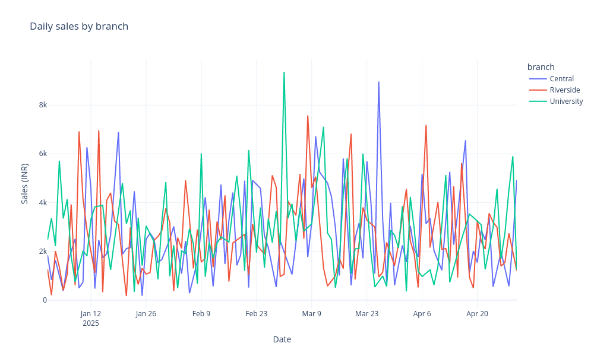
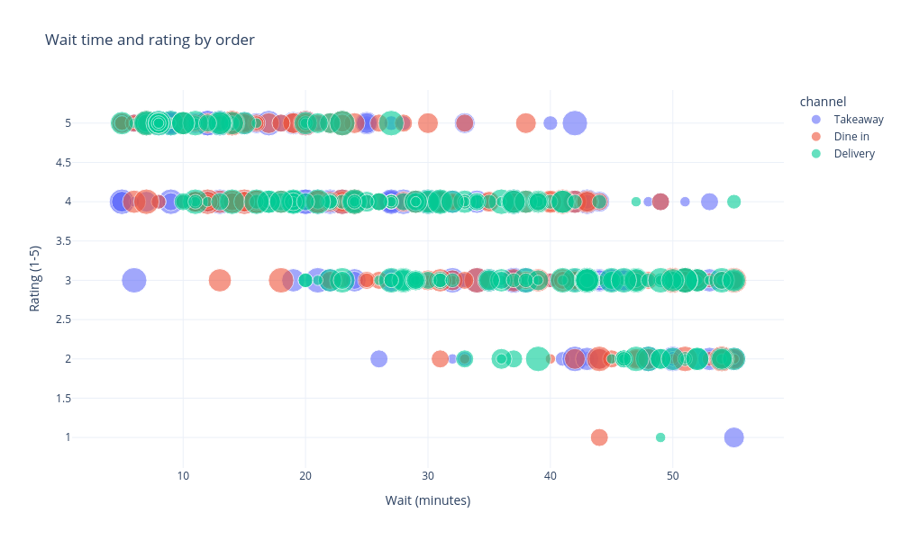
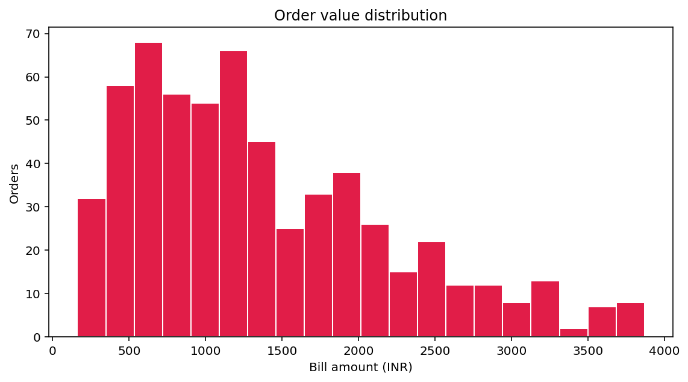
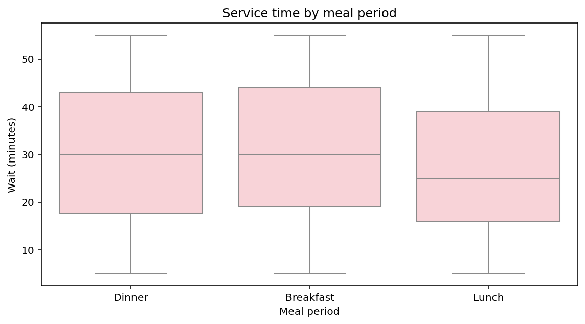
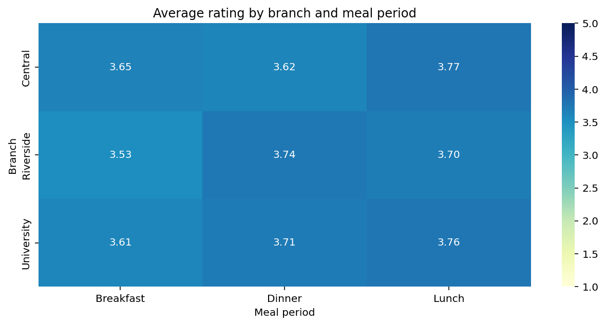

# Restaurant Operations - an executed Python and Streamlit tutorial

**Run the lesson:** [Open the step-by-step Jupyter notebook](TUTORIAL.ipynb) for executable cells, saved outputs, checkpoints, and practice tasks.

This Markdown tutorial takes the [actual restaurant CSV](restaurant_orders.csv) from a business question through commented Python analysis to a working Streamlit application. Every analysis cell has its **executed output** or a chart generated by that cell, followed by the reasoning behind the calculation. Printed outputs and chart images were captured using the committed data.

**How to run it:** Markdown shows static code and captured results. Start a fresh notebook or interactive Python session with this project folder as the working directory, then run the analysis cells in order in one session. Variables are shared between cells. A bare final `fig` displays a figure in a notebook; use `fig.show()` for Plotly or `plt.show()` for Matplotlib in a plain Python script. The final Streamlit cell is a **separate, complete application**: save it as `practice_app.py` beside the CSV and run it with Streamlit. It does not depend on the notebook namespace and should not replace the original `app.py`.

The [existing app](app.py) and CSV match revision [`c10a61c36fffdd048b69dd78926e6663bc986fce`](https://github.com/cookieSensei/programming-and-ai/blob/c10a61c36fffdd048b69dd78926e6663bc986fce/business_analytics_workshop/06_restaurant_operations/app.py). The tutorial rearranges those operations for learning and labels additional diagnostics as extensions. All orders are fictional; monetary amounts are INR; January-April 2025 is a teaching period, not live restaurant performance.

## Learning route

1. [The business question](#the-business-question)
2. [Prepare and inspect the source](#prepare-and-inspect-the-source)
3. [Filter orders and calculate useful measures](#filter-orders-and-calculate-useful-measures)
4. [Produce and interpret all five charts](#produce-and-interpret-all-five-charts)
5. [Inspect, report, and investigate](#inspect-report-and-investigate)
6. [Build the Streamlit application](#build-the-streamlit-application)
7. [Understand the original app and its limits](#understand-the-original-app-and-its-limits)
8. [References](#references)

## The business question

A restaurant manager wants to understand sales alongside the service experience. Which branches contribute revenue? Where do orders wait longest? Do lower ratings coincide with longer waits? Which branch/meal-period combinations deserve investigation? A single sales total or average rating cannot answer all of those questions.

This dashboard connects commercial measures with service measures. It separates **bill per order** from **sales per guest**, **food-cost contribution** from **net profit**, and **observed association** from **cause and effect**. Its useful outcome is a better operational question, such as whether comparable dinner orders at a particular branch need a process review. It does not optimize staffing or prove why a rating was low.

One row is **one order**. Guests are counted inside that order. There is no customer identifier for deduplicating repeat visitors, and no staffing, capacity, food-preparation breakdown, or customer-comment field.

| Source field | Meaning and unit |
| --- | --- |
| `order_id`, `date` | Synthetic order identity and order date |
| `branch`, `meal_period`, `channel` | Location, service period, and order channel |
| `guests` | Guests associated with that order |
| `bill_amount`, `food_cost` | Billed sales and recorded food cost, INR |
| `wait_minutes` | Recorded service wait, minutes |
| `rating` | Recorded score, intended range 1-5 |

**Why pandas?** A `DataFrame` gives named columns, row selection, date parsing, group summaries, percentile calculations, correlation, and CSV export in one table-oriented tool. The code can closely match the question: group orders by branch, then sum bills and average waits. Python could do these tasks with loops and dictionaries, but pandas reduces repetitive bookkeeping. It does not decide whether a mean, sum, or denominator makes business sense; that is what the explanations below address.

## Prepare and inspect the source

Use Python 3.12 and the [workshop environment](../README.md). From the repository root in a Linux/macOS terminal:

```bash
python -m venv .venv
source .venv/bin/activate
python -m pip install streamlit==1.50.0 pandas==2.2.3 numpy==2.3.5 matplotlib==3.10.8 seaborn==0.13.2 plotly==6.5.2
cd business_analytics_workshop/06_restaurant_operations
```

Use this environment as your notebook kernel, or its Python console. JupyterLab or VS Code notebook support is a separate notebook tool if not already installed. CookieSensei's prepared workspace provides the analysis environment. For a full Windows checkout, use WSL or the Linux Cloud Lab as explained in the [root README](../../README.md), because other phase directories contain `>` in their names. The captured chart PNGs below are already available; ordinary interactive Plotly display does not require an image-export package.

### Cell 01 - Import the tools and locate the source

**Question:** Which tools serve the analysis, and can this session see the CSV?

<!-- cell:analysis:01 -->

```python
from pathlib import Path             # Locate a local file without hard-coding a machine path.
import pandas as pd                  # Load and analyze rectangular data.
import matplotlib.pyplot as plt      # Make figures, axes, and a histogram.
import seaborn as sns                # Compare distributions and draw a matrix heatmap.
import plotly.express as px          # Make interactive line and scatter charts.

DATA_FILE = Path('restaurant_orders.csv')  # Run notebook cells from this project folder.
print(f'Dataset: {DATA_FILE.name}')
print(f'File exists: {DATA_FILE.is_file()}')
```

**Output**

```text
Dataset: restaurant_orders.csv
File exists: True
```

**Interpretation and reasoning**

pandas handles the records and calculations. The three plotting libraries express different visual views; Streamlit will display them in a browser later. A notebook normally has no `__file__`, so this cell relies on the stated working directory. The original saved app instead uses its own file path to locate the sibling CSV, which is independent of the terminal directory.

### Cell 02 - Read actual orders before calculating anything

**Question:** What does one input row really say?

<!-- cell:analysis:02 -->

```python
frame = pd.read_csv(DATA_FILE)         # Parse headers and rows into one DataFrame.
print(f'Orders: {len(frame)} | Source columns: {len(frame.columns)}')
print(frame.head(4).to_string(index=False))  # Show a small source sample, not synthetic rows.
```

**Output**

```text
Orders: 600 | Source columns: 10
 order_id       date     branch meal_period  channel  guests  bill_amount  food_cost  wait_minutes  rating
DINE-0001 2025-01-01    Central      Dinner Takeaway       1       470.12     102.74            54       3
DINE-0002 2025-01-02 University   Breakfast  Dine in       3      1242.74     381.17            47       3
DINE-0003 2025-01-03    Central       Lunch Delivery       3      1430.24     370.61            34       4
DINE-0004 2025-01-04 University      Dinner  Dine in       6      1858.33     809.89            55       3
```

**Interpretation and reasoning**

The first order is Central / Dinner / Takeaway for one guest, with bill INR 470.12, food cost INR 102.74, wait 54 minutes, and rating 3. Those are recorded attributes; the row does not tell us why the wait or score occurred. `head(4)` limits inspection output without changing the full `frame`. The order count is not a count of unique customers.

### Cell 03 - Check row identity and the available comparison groups

**Question:** Are repeated orders or unexpected group labels affecting the planned comparisons?

<!-- cell:analysis:03 -->

```python
# Check order identity separately from distinct group labels before counting or aggregating.
print(f'Unique order IDs: {frame["order_id"].nunique()}')
print(f'Repeated order IDs: {frame["order_id"].duplicated().sum()}')
for column in ['branch', 'meal_period', 'channel']:
    print(f'{column}: {", ".join(sorted(frame[column].unique()))}')
```

**Output**

```text
Unique order IDs: 600
Repeated order IDs: 0
branch: Central, Riverside, University
meal_period: Breakfast, Dinner, Lunch
channel: Delivery, Dine in, Takeaway
```

**Interpretation and reasoning**

The actual file has 600 distinct order IDs and the three expected grouping dimensions. Checking repeated order IDs is an **extra diagnostic**: the original app reports exact duplicate rows but does not enforce unique IDs. A record count using `.size()` counts rows even if a future CSV repeats an identifier. A unique order ID still does not identify a unique customer across orders.

### Cell 04 - Parse dates and required numbers explicitly

**Question:** Can the code treat dates as dates and measured quantities as numbers?

<!-- cell:analysis:04 -->

```python
frame['date'] = pd.to_datetime(frame['date'], errors='raise')  # Enable date comparisons/grouping.
numeric_columns = ['guests', 'bill_amount', 'food_cost', 'wait_minutes', 'rating']
for column in numeric_columns:
    frame[column] = pd.to_numeric(frame[column], errors='raise')

print(frame.dtypes.to_string())
print('Date interval:', frame['date'].min().date(), 'to', frame['date'].max().date())
```

**Output**

```text
order_id                object
date            datetime64[ns]
branch                  object
meal_period             object
channel                 object
guests                   int64
bill_amount            float64
food_cost              float64
wait_minutes             int64
rating                   int64
Date interval: 2025-01-01 to 2025-04-30
```

**Interpretation and reasoning**

`errors="raise"` rejects unparseable content rather than silently converting it to missing values. It does not check that guests are positive integers, waits are nonnegative, or ratings fall between one and five. The intended field meaning and its enforced validation are different things. The code uses no direct NumPy operation even though NumPy belongs to the shared environment.

### Cell 05 - Validate required records and report source quality

**Question:** Is required input available, and which structural problems can we detect?

<!-- cell:analysis:05 -->

```python
required = ['order_id', 'date', 'branch', 'meal_period', 'channel',
            'guests', 'bill_amount', 'food_cost', 'wait_minutes', 'rating']
if not set(required).issubset(frame.columns):
    raise ValueError('The CSV is missing required columns.')
if frame.empty:
    raise ValueError('The CSV contains no rows.')
if frame[required].isna().any().any():  # Missing-cell flags are reduced over both axes.
    raise ValueError('Fill missing required values before analysis.')

quality = pd.DataFrame({'field': frame.columns,
                        'missing': frame.isna().sum().values})
print(quality.to_string(index=False))
print(f'Exact duplicate rows: {frame.duplicated().sum()}')
```

**Output**

```text
       field  missing
    order_id        0
        date        0
      branch        0
 meal_period        0
     channel        0
      guests        0
 bill_amount        0
   food_cost        0
wait_minutes        0
      rating        0
Exact duplicate rows: 0
```

**Interpretation and reasoning**

The bundled file passes these checks. The original app follows the same missing-value policy and displays a useful error before stopping; this notebook lets the exception interrupt the cell. Parsing comes before the schema check, so a missing date header can raise `KeyError` earlier. No values are imputed, no outliers are dropped, and no proof of representativeness follows from the absence of missing cells.

## Filter orders and calculate useful measures

### Cell 06 - Reproduce the sidebar selection as ordinary Python values

**Question:** Which exact orders should feed every following calculation?

<!-- cell:analysis:06 -->

```python
selected_branches = sorted(frame['branch'].unique())
selected_meals = sorted(frame['meal_period'].unique())
start_date = frame['date'].min().date()
end_date = frame['date'].max().date()

filtered = frame.copy()  # Preserve the full source for its separate quality summary.
filtered = filtered[filtered['branch'].isin(selected_branches)]
filtered = filtered[filtered['meal_period'].isin(selected_meals)]
filtered = filtered[filtered['date'].dt.date.between(start_date, end_date)]
if filtered.empty:
    raise ValueError('No orders match the chosen filters.')

print(f'Selected orders: {len(filtered)} of {len(frame)}')
print(f'Inclusive interval: {start_date} to {end_date}')
```

**Output**

```text
Selected orders: 600 of 600
Inclusive interval: 2025-01-01 to 2025-04-30
```

**Interpretation and reasoning**

Membership tests create Boolean masks, and indexing with each mask keeps matching rows. The conditions combine as AND because they are applied successively. Date endpoints are included. The default selection retains all rows. The original app has branch, meal-period, and date widgets; it does **not** yet have a channel sidebar filter. Later channel comparisons are marked as an extension.

### Cell 07 - Derive food-cost contribution for every selected order

**Question:** What remains from each bill after its recorded food cost?

<!-- cell:analysis:07 -->

```python
# Subtract paired costs from paired bills; pandas aligns values by their row labels.
filtered['contribution'] = filtered['bill_amount'] - filtered['food_cost']
print(filtered[['order_id', 'bill_amount', 'food_cost', 'contribution']]
      .head(4).to_string(index=False))
```

**Output**

```text
 order_id  bill_amount  food_cost  contribution
DINE-0001       470.12     102.74        367.38
DINE-0002      1242.74     381.17        861.57
DINE-0003      1430.24     370.61       1059.63
DINE-0004      1858.33     809.89       1048.44
```

**Interpretation and reasoning**

The first order leaves INR 367.38 after food cost. This is **food-cost contribution**, not net profit: staffing, rent, fees, tax, and other costs are absent. The new column is in the working table and exported selected rows, but the original CSV is unchanged. Row-wise subtraction preserves the relationship between each bill and its associated food cost.

### Cell 08 - Calculate the four visible dashboard cards

**Question:** What commercial and service experience does the selected set of orders represent?

<!-- cell:analysis:08 -->

```python
def ratio(numerator, denominator):  # Same scalar safeguard used in the original app.
    return numerator / denominator if denominator else 0.0

sales = filtered['bill_amount'].sum()
average_bill = filtered['bill_amount'].mean()
average_wait = filtered['wait_minutes'].mean()
average_rating = filtered['rating'].mean()
print(f'Sales: INR {sales:,.2f}')
print(f'Average bill: INR {average_bill:,.2f}')
print(f'Average wait: {average_wait:.2f} minutes')
print(f'Average rating: {average_rating:.2f} / 5')
```

**Output**

```text
Sales: INR 821,005.18
Average bill: INR 1,368.34
Average wait: 29.56 minutes
Average rating: 3.67 / 5
```

**Interpretation and reasoning**

Sales add recorded billed amounts. The three means give every order equal influence because each required measurement is present. Mean rating is a score out of five, not a percentage of satisfied customers. A single mean can hide a long service tail or different subgroup experiences, so the next cells preserve the same selection while examining those details.

### Cell 09 - Compare per-order and per-guest denominators

**Question:** Why is dividing total sales by total guests different from averaging a per-order rate?

<!-- cell:analysis:09 -->

```python
guests = filtered['guests'].sum()          # Guest appearances associated with these orders.
sales_per_guest = ratio(sales, guests)     # Ratio of totals, as implemented in the app.
mean_order_guest_rate = filtered['bill_amount'].div(filtered['guests']).mean()

print(f'Orders: {len(filtered)} | Guest appearances: {guests}')
print(f'Average bill per order: INR {average_bill:,.2f}')
print(f'Sales per guest from totals: INR {sales_per_guest:,.2f}')
print(f'Unweighted mean of order-level bill/guest: INR {mean_order_guest_rate:,.2f}')
```

**Output**

```text
Orders: 600 | Guest appearances: 2075
Average bill per order: INR 1,368.34
Sales per guest from totals: INR 395.67
Unweighted mean of order-level bill/guest: INR 399.40
```

**Interpretation and reasoning**

The app's INR 395.67 ratio gives a larger party proportionally more denominator weight. The INR 399.40 unweighted mean gives each order the same influence, regardless of its guest count. The latter is an added diagnostic, not the implemented KPI. Both also differ from INR 1,368.34 per order. The bundled guest counts are positive; with a zero guest total, the helper's fallback zero would not be a meaningful defined rate. Guest appearances are not deduplicated people.

### Cell 10 - Summarize branches with counts beside their averages

**Question:** Where do sales and service differences appear, and how many orders support them?

<!-- cell:analysis:10 -->

```python
branch_summary = filtered.groupby('branch').agg(
    orders=('order_id', 'size'),             # Count observations, not distinct customer IDs.
    sales=('bill_amount', 'sum'),
    contribution=('contribution', 'sum'),
    average_wait=('wait_minutes', 'mean'),
    average_rating=('rating', 'mean'),
)
print(branch_summary.round(2).to_string())
```

**Output**

```text
            orders      sales  contribution  average_wait  average_rating
branch
Central        196  268251.90     195821.64         29.03            3.67
Riverside      196  270820.33     197322.47         29.64            3.65
University     208  281932.95     200767.77         30.00            3.68
```

**Interpretation and reasoning**

Named aggregation produces several summaries per branch in one table. `.size()` counts rows; `.sum()` combines amounts; `.mean()` describes order-weighted experiences. University has more observed orders than the other branches. Neither its sales total nor its mean wait adjusts for capacity, opening hours, channel mix, or party size.

### Cell 11 - Find the labels behind sales and wait leaders

**Question:** Which branch should we inspect first, and what exactly is the ranking based on?

<!-- cell:analysis:11 -->

```python
sales_leader = branch_summary['sales'].idxmax()       # Return the label of the maximum, not its value.
slowest = branch_summary['average_wait'].idxmax()
print(f'Sales leader: {sales_leader} / INR {branch_summary.loc[sales_leader, "sales"]:,.2f}')
print(f'Greatest mean wait: {slowest} / {branch_summary.loc[slowest, "average_wait"]:.2f} minutes')
print(f'Orders supporting that wait: {branch_summary.loc[slowest, "orders"]}')
```

**Output**

```text
Sales leader: University / INR 281,932.95
Greatest mean wait: University / 30.00 minutes
Orders supporting that wait: 208
```

**Interpretation and reasoning**

`idxmax()` returns an index label, and `.loc[label, column]` retrieves its supporting value. University leads both measures in this selection, but its average wait is only slightly greater than the other branches. The app computes no uncertainty test for that gap. Ties return the first maximum in grouped order rather than proving a uniquely best or worst branch.

### Cell 12 - Look beyond the mean at the service tail

**Question:** Does an acceptable-looking average hide much slower experiences?

<!-- cell:analysis:12 -->

```python
# Median locates the center; the 0.9 quantile estimates a boundary toward the slow end.
median_wait = filtered['wait_minutes'].median()
p90_wait = filtered['wait_minutes'].quantile(0.9)
print(f'Mean wait: {average_wait:.2f} minutes')
print(f'Median wait: {median_wait:.2f} minutes')
print(f'90th-percentile wait: {p90_wait:.2f} minutes')
print(f'Maximum observed wait: {filtered["wait_minutes"].max()} minutes')
```

**Output**

```text
Mean wait: 29.56 minutes
Median wait: 29.00 minutes
90th-percentile wait: 50.00 minutes
Maximum observed wait: 55 minutes
```

**Interpretation and reasoning**

The median is the middle sorted wait; the 90th percentile describes the slower end. pandas uses interpolation by default, so a percentile need not equal an observed value. The 50-minute result here is not a maximum or a service guarantee. Ties and finite sample sizes also mean exactly 10% of orders need not be strictly above it. Maximum wait is an additional diagnostic in this cell; the original app's service-tail sentence reports median and p90.

### Cell 13 - Measure the observed wait/rating association

**Question:** Do longer waits tend to accompany lower ratings in the selected records?

<!-- cell:analysis:13 -->

```python
# Pearson correlation describes the selected paired values; it does not model cause and effect.
association = (
    filtered['wait_minutes'].corr(filtered['rating'])
    if len(filtered) > 1 else float('nan')
)
if pd.notna(association):
    print(f'Pearson correlation: {association:.6f}')
    print('This is a linear association across selected orders, not a causal effect.')
else:
    print('Correlation is undefined because data is insufficient or constant.')
```

**Output**

```text
Pearson correlation: -0.740139
This is a linear association across selected orders, not a causal effect.
```

**Interpretation and reasoning**

The coefficient is about -0.74. It has no units and is not the number of rating points lost per extra minute. The negative sign describes direction of linear association, while the magnitude summarizes its strength in these observations. It does not prove that changing wait alone changes ratings. More than one row is necessary but not sufficient: a constant wait or rating column can still make correlation undefined. No significance test, confidence interval, or causal adjustment is performed.

### Cell 14 - Count the evidence behind branch/meal-period cells

**Question:** Are subgroup averages supported by comparable amounts of data?

<!-- cell:analysis:14 -->

```python
# Count observations in each two-dimensional group before interpreting its average rating.
cell_counts = filtered.groupby(['branch', 'meal_period']).size()
print(cell_counts.rename('orders').reset_index().to_string(index=False))
print(f'Smallest observed group: {cell_counts.min()} orders')
print(f'Observed groups below 20 orders: {(cell_counts < 20).sum()}')
```

**Output**

```text
    branch meal_period  orders
   Central   Breakfast      63
   Central      Dinner      73
   Central       Lunch      60
 Riverside   Breakfast      68
 Riverside      Dinner      61
 Riverside       Lunch      67
University   Breakfast      84
University      Dinner      58
University       Lunch      66
Smallest observed group: 58 orders
Observed groups below 20 orders: 0
```

**Interpretation and reasoning**

The smallest full-data group has 58 orders. Twenty is only an illustrative caution threshold used by the original app, not a reliability guarantee. Entirely absent combinations are not counted as observed groups. A group mean can still hide dispersion or unrepresentative sampling even when its count exceeds 20. `reset_index()` turns the two grouping labels back into ordinary columns for display.

### Cell 15 - Build daily sales at the grain required by a line chart

**Question:** What should one point in a branch-sales line represent?

<!-- cell:analysis:15 -->

```python
# One chart point requires one observed date/branch group; no missing groups are filled with zero.
daily = filtered.groupby(['date', 'branch'], as_index=False)['bill_amount'].sum()
print(daily.head(8).to_string(index=False))
print(f'Observed branch/date combinations: {len(daily)}')
print(f'Possible combinations within observed dates: {filtered["date"].nunique() * filtered["branch"].nunique()}')
```

**Output**

```text
      date     branch  bill_amount
2025-01-01    Central      1850.49
2025-01-01  Riverside      1267.86
2025-01-01 University      2463.18
2025-01-02    Central       825.68
2025-01-02  Riverside       202.15
2025-01-02 University      3363.16
2025-01-03    Central      1635.14
2025-01-03  Riverside      2009.09
Observed branch/date combinations: 307
Possible combinations within observed dates: 360
```

**Interpretation and reasoning**

One point is the sum of bills for one observed branch/date combination. Grouping both dimensions prevents mixing branch totals into one undifferentiated daily amount. `as_index=False` leaves chart fields as normal columns. The difference between observed and possible combinations illustrates why an absent branch/date must not automatically become a zero-sales observation; this is not an audited complete trading calendar.

## Produce and interpret all five charts

The images below are generated outputs of the preceding cells. Their source measurements, denominators, and grouping choices determine what they can answer. Styling is adjusted for this static teaching page without changing the analytical values.

### Cell 16 - Plot sales patterns for each branch

**Question:** Which observed branches and dates account for selected sales?

<!-- cell:analysis:16 -->

```python
fig = px.line(
    daily, x='date', y='bill_amount', color='branch',
    title='Daily sales by branch', labels={'date': 'Date', 'bill_amount': 'Sales (INR)'},
)
fig.update_layout(template='plotly_white')  # Styling only; no missing days are inserted.
fig
```

**Output**



**Interpretation and reasoning**

Each colored line connects that branch's observed daily totals. A line segment across an absent date is not a recorded value for that date. The chart provides timing and scale context, but it does not normalize by capacity or estimate a sales forecast. The table in the previous cell lets you trace a plotted point to its exact grouped amount.

### Cell 17 - Plot wait and rating while retaining order-level context

**Question:** What individual-order pattern lies behind the correlation coefficient?

<!-- cell:analysis:17 -->

```python
# Preserve one point per order; color and bubble size add channel and party-size context.
fig = px.scatter(
    filtered, x='wait_minutes', y='rating', color='channel', size='guests',
    hover_data=['order_id', 'branch', 'bill_amount'], opacity=0.6,
    title='Wait time and rating by order',
    labels={'wait_minutes': 'Wait (minutes)', 'rating': 'Rating (1-5)'},
)
fig.update_layout(template='plotly_white')
fig
```

**Output**



**Interpretation and reasoning**

Every point is an order. Channel controls color and guest count controls bubble size; hover in an interactive notebook identifies the source order. Discrete ratings create overlapping bands, and opacity helps show density. Bubble size does not make the Pearson calculation guest-weighted. The chart shows association and context, but cannot identify the operational cause of a low rating.

### Cell 18 - Inspect the distribution of bill amounts

**Question:** Is the average bill representative of an ordinary order?

<!-- cell:analysis:18 -->

```python
# The histogram counts orders within bill ranges rather than summing sales inside each range.
fig, ax = plt.subplots(figsize=(8, 4.5))
ax.hist(filtered['bill_amount'], bins=20, color='#e11d48', edgecolor='white')
ax.set(title='Order value distribution', xlabel='Bill amount (INR)', ylabel='Orders')
fig.tight_layout()
fig
```

**Output**



**Interpretation and reasoning**

The histogram counts orders in each bill range. Large-party bills can create a right-hand tail and lift the mean, so a high bill does not necessarily mean higher spending per guest. The 20-bin choice changes the display detail rather than the data. The original app displays Matplotlib figures through `st.pyplot(fig)` and closes them with `plt.close(fig)` to avoid accumulating resources across reruns.

### Cell 19 - Compare typical waits and variability across meal periods

**Question:** Which service periods show longer or more variable waits?

<!-- cell:analysis:19 -->

```python
# The boxes summarize individual waits within each meal period; they do not show totals.
fig, ax = plt.subplots(figsize=(8, 4.5))
sns.boxplot(data=filtered, x='meal_period', y='wait_minutes', ax=ax, color='#fecdd3')
ax.set(title='Service time by meal period', xlabel='Meal period', ylabel='Wait (minutes)')
fig.tight_layout()
fig
```

**Output**



**Interpretation and reasoning**

The middle line is the median and the box spans the middle half. Default whiskers reach observations within 1.5 interquartile ranges; more distant points are retained as observations. This compares distributions rather than just means. Branches, channels, and party sizes are mixed within each period, so the difference is not a direct estimate of staffing performance.

### Cell 20 - Locate subgroup ratings in a fixed-scale heatmap

**Question:** Which branch/meal-period combinations deserve a closer look at customer experience?

<!-- cell:analysis:20 -->

```python
rating_grid = filtered.pivot_table(
    index='branch', columns='meal_period', values='rating', aggfunc='mean'
)  # A cell is an order-weighted mean score for one observed combination.
fig, ax = plt.subplots(figsize=(9, 4.5))
sns.heatmap(rating_grid, annot=True, fmt='.2f', vmin=1, vmax=5, cmap='YlGnBu', ax=ax)
ax.set(title='Average rating by branch and meal period', xlabel='Meal period', ylabel='Branch')
fig.tight_layout()
fig
```

**Output**



**Interpretation and reasoning**

The cell numbers are scores out of five, not correlation coefficients. Fixed limits from one to five keep colors comparable across selections, but small differences may look subtle and are not automatically meaningful. Inspect the sample counts from the earlier cell alongside the means. Missing combinations remain missing rather than receiving a zero score; wholly unobserved labels can be absent from the pivot axes.

## Inspect, report, and investigate

### Cell 21 - Summarize distributions of the actual numeric columns

**Question:** Which numeric values and spreads should we inspect before telling the story?

<!-- cell:analysis:21 -->

```python
# Keep numeric fields only, then report their order-level counts, center, spread, and extremes.
numeric_summary = filtered.select_dtypes(include='number').describe().round(2)
print(numeric_summary.to_string())
```

**Output**

```text
       guests  bill_amount  food_cost  wait_minutes  rating  contribution
count  600.00       600.00     600.00        600.00  600.00        600.00
mean     3.46      1368.34     378.49         29.56    3.67        989.85
std      1.68       845.54     202.08         14.66    0.95        718.82
min      1.00       161.68      70.13          5.00    1.00         14.42
25%      2.00       676.59     211.99         17.00    3.00        438.18
50%      3.00      1177.32     354.16         29.00    4.00        804.54
75%      5.00      1894.42     533.61         42.00    4.00       1393.82
max      6.00      3870.32     898.57         55.00    5.00       3316.21
```

**Interpretation and reasoning**

`describe()` summarizes the selected order-level columns, including the derived contribution. Count is available measurements, mean is the arithmetic average, standard deviation measures spread, and the quartiles locate parts of the ordered distribution. Do not compare unlike units as if their numeric magnitudes had the same meaning: minutes, guests, INR, and rating points are different quantities.

### Cell 22 - Generate a short report from calculated values

**Question:** How can the program produce a readable finding from the same values as the charts?

<!-- cell:analysis:22 -->

```python
# Tutorial-sized reconstruction: the original app assembles 12 richer report sections.
scope = f'{len(filtered)} selected orders; {start_date} to {end_date} inclusive'
finding = (
    f'Sales are INR {sales:,.2f} across {guests:,} guest appearances. '
    f'Food-cost contribution is INR {filtered["contribution"].sum():,.2f} before other costs.'
)
report_parts = [
    '# Restaurant operations - teaching report',
    '## Scope\n' + scope,
    '## Commercial result\n' + finding,
    f'## Service\nMean wait: {average_wait:.2f} minutes; median: {median_wait:.2f}; p90: {p90_wait:.2f}.',
    f'## Ratings\nMean score: {average_rating:.2f}/5; wait/rating correlation: {association:.2f}.',
    '## Limit\nThese fictional associations do not establish the cause of service or rating differences.',
]
teaching_report = '\n\n'.join(report_parts)
print(teaching_report)
```

**Output**

```text
# Restaurant operations - teaching report

## Scope
600 selected orders; 2025-01-01 to 2025-04-30 inclusive

## Commercial result
Sales are INR 821,005.18 across 2,075 guest appearances. Food-cost contribution is INR 593,911.88 before other costs.

## Service
Mean wait: 29.56 minutes; median: 29.00; p90: 50.00.

## Ratings
Mean score: 3.67/5; wait/rating correlation: -0.74.

## Limit
These fictional associations do not establish the cause of service or rating differences.
```

**Interpretation and reasoning**

The f-strings insert current numbers into defined sentences; the list and join operation build Markdown. No AI model or external service writes the finding. This shorter report demonstrates the original app's assembly technique rather than replacing its complete report. The actual app also includes all chart guides, formulas, quality checks, next steps, and limitations, then uses one shared string for display and download.

### Cell 23 - Inspect the exact selected CSV payload

**Question:** Which observations can a reader use to reproduce or check the analysis?

<!-- cell:analysis:23 -->

```python
csv_text = filtered.to_csv(index=False)    # Include contribution, omit pandas row labels.
print('\n'.join(csv_text.splitlines()[:5]))  # Preview the header and first four orders.
print(f'Data records in the export: {len(filtered)}')
```

**Output**

```text
order_id,date,branch,meal_period,channel,guests,bill_amount,food_cost,wait_minutes,rating,contribution
DINE-0001,2025-01-01,Central,Dinner,Takeaway,1,470.12,102.74,54,3,367.38
DINE-0002,2025-01-02,University,Breakfast,Dine in,3,1242.74,381.17,47,3,861.5699999999999
DINE-0003,2025-01-03,Central,Lunch,Delivery,3,1430.24,370.61,34,4,1059.63
DINE-0004,2025-01-04,University,Dinner,Dine in,6,1858.33,809.89,55,3,1048.44
Data records in the export: 600
```

**Interpretation and reasoning**

This is the actual unrounded CSV string from the selected DataFrame. It includes source fields plus contribution and retains one row per order. It does not include the separate branch-summary or heatmap tables. Long decimal tails can reflect binary floating-point subtraction; the original app exports the same unrounded working values. The source CSV remains untouched.

### Cell 24 - Recalculate a specific operational question

**Question:** What changes when we inspect one branch and one meal period instead of mixing all orders?

<!-- cell:analysis:24 -->

```python
# Build a separate scenario so the default filtered table remains unchanged.
scenario = frame[
    (frame['branch'] == 'University') & (frame['meal_period'] == 'Dinner')
].copy()
print(f'Scenario: University / Dinner | Orders: {len(scenario)}')
print(f'Sales: INR {scenario["bill_amount"].sum():,.2f}')
print(f'Mean wait: {scenario["wait_minutes"].mean():.2f} minutes')
print(f'Median wait: {scenario["wait_minutes"].median():.2f} minutes')
print(f'90th-percentile wait: {scenario["wait_minutes"].quantile(0.9):.2f} minutes')
print(f'Mean rating: {scenario["rating"].mean():.2f}/5')
```

**Output**

```text
Scenario: University / Dinner | Orders: 58
Sales: INR 83,582.52
Mean wait: 31.59 minutes
Median wait: 34.00 minutes
90th-percentile wait: 50.30 minutes
Mean rating: 3.71/5
```

**Interpretation and reasoning**

Parentheses define each condition, and `&` combines them elementwise. This group has 58 observed orders. The source app reaches the same population with its branch and meal-period widgets, retaining the full date window. The result can guide an investigation, but channel, party size, staffing, and unrecorded customer expectations can still differ within or between groups.

### Cell 25 - Add a channel comparison as an explicit extension

**Question:** Could order channel be relevant context when comparing branch experiences?

<!-- cell:analysis:25 -->

```python
# Extension: the original app colors points by channel but does not show this summary table.
channel_summary = filtered.groupby('channel').agg(
    orders=('order_id', 'size'),
    sales=('bill_amount', 'sum'),
    guests=('guests', 'sum'),
    average_wait=('wait_minutes', 'mean'),
    average_rating=('rating', 'mean'),
)
channel_summary['sales_per_guest'] = channel_summary['sales'].div(
    channel_summary['guests'].replace(0, float('nan'))
)
print(channel_summary.round(2).to_string())
```

**Output**

```text
          orders      sales  guests  average_wait  average_rating  sales_per_guest
channel
Delivery     200  268089.82     691         31.20            3.58           387.97
Dine in      208  277998.93     704         29.13            3.73           394.88
Takeaway     192  274916.43     680         28.32            3.70           404.29
```

**Interpretation and reasoning**

This added table repeats the same principles at a new grain: counts beside means and a ratio of totals for sales per guest. It is not an existing sidebar filter or proof that channel causes a difference. To add a channel widget later, apply its `.isin()` mask before deriving metrics and before the final empty-data guard, so every downstream output uses the new selection consistently.

## Build the Streamlit application

The analysis does not need a separate spreadsheet step before becoming a web interface. Streamlit widgets return ordinary Python values, pandas uses them to select records, and display calls present the calculated values. The program runs on the server machine while the viewer uses a browser.

The following cell is a **complete compact reconstruction**, with the original filter dimensions, KPI definitions, all five chart types, a selected-record export, and a shorter Markdown report. The existing `app.py` additionally contains detailed context, visual explanations, source-quality panels, and its 12-section report. Save this cell as `practice_app.py` beside `restaurant_orders.csv` and run it separately:

```bash
python -m streamlit run practice_app.py
```

Use `--server.port 8502` in a workshop workspace when its built-in dashboard uses 8501, then open the forwarded port. This cell is self-contained and does not rely on variables created in the earlier notebook cells.

### Cell 26 - Turn the analysis into an interactive operations dashboard

**Question:** How can someone explore the same calculations through controls, charts, and downloads?

<!-- cell:streamlit:26 -->

```python
from pathlib import Path
import pandas as pd
import matplotlib.pyplot as plt
import seaborn as sns
import plotly.express as px
import streamlit as st

st.set_page_config(page_title='Restaurant Operations Dashboard', layout='wide')
st.title('Restaurant Operations Dashboard')
st.caption('Fictional teaching orders | Currency: INR | Ratings: 1-5')

# A saved script finds its own sibling CSV, even if launched from another directory.
data_file = Path(__file__).resolve().with_name('restaurant_orders.csv')
try:
    frame = pd.read_csv(data_file)
    frame['date'] = pd.to_datetime(frame['date'], errors='raise')
    required = ['order_id', 'date', 'branch', 'meal_period', 'channel',
                'guests', 'bill_amount', 'food_cost', 'wait_minutes', 'rating']
    if not set(required).issubset(frame.columns) or frame.empty:
        raise ValueError('Provide all required columns and at least one order.')
    for column in ['guests', 'bill_amount', 'food_cost', 'wait_minutes', 'rating']:
        frame[column] = pd.to_numeric(frame[column], errors='raise')
    if frame[required].isna().any().any():
        raise ValueError('Fill missing required values first.')
except (OSError, ValueError, KeyError) as error:
    st.error(f'Could not load the dataset: {error}')
    st.stop()

def ratio(numerator, denominator):
    return numerator / denominator if denominator else 0.0

# Widget values feed the analysis; the widgets themselves do not change frame.
branches_chosen = st.sidebar.multiselect(
    'Branches', sorted(frame['branch'].unique()),
    default=sorted(frame['branch'].unique()), key='practice_restaurant_branches',
)
meals_chosen = st.sidebar.multiselect(
    'Meal periods', sorted(frame['meal_period'].unique()),
    default=sorted(frame['meal_period'].unique()), key='practice_restaurant_meals',
)
dates = st.sidebar.date_input(
    'Date range', (frame['date'].min().date(), frame['date'].max().date()),
    min_value=frame['date'].min().date(), max_value=frame['date'].max().date(),
    key='practice_restaurant_dates',
)
if len(dates) != 2:
    st.info('Choose both a start and an end date.')
    st.stop()
filtered = frame[
    frame['branch'].isin(branches_chosen)
    & frame['meal_period'].isin(meals_chosen)
    & frame['date'].dt.date.between(dates[0], dates[1])
].copy()
if filtered.empty:
    st.info('No orders match these filters.')
    st.stop()

# Calculate only after the complete selection and its empty-data guard.
filtered['contribution'] = filtered['bill_amount'] - filtered['food_cost']
sales = filtered['bill_amount'].sum()
cards = st.columns(4)
cards[0].metric('Sales (INR)', f'{sales:,.0f}')
cards[1].metric('Average bill (INR)', f'{filtered["bill_amount"].mean():,.0f}')
cards[2].metric('Average wait', f'{filtered["wait_minutes"].mean():.1f} min')
cards[3].metric('Average rating', f'{filtered["rating"].mean():.2f} / 5')
st.caption('Contribution excludes staffing, rent, delivery fees and tax. Observed associations are not causal effects.')

branch_summary = filtered.groupby('branch').agg(
    orders=('order_id', 'size'), sales=('bill_amount', 'sum'),
    contribution=('contribution', 'sum'), average_wait=('wait_minutes', 'mean'),
    average_rating=('rating', 'mean'),
)
daily = filtered.groupby(['date', 'branch'], as_index=False)['bill_amount'].sum()
cell_counts = filtered.groupby(['branch', 'meal_period']).size()

# Tabs determine placement; their code still runs during a normal full rerun.
dashboard, explore, records, report_tab = st.tabs(['Dashboard', 'Explore', 'Data', 'Report'])
with dashboard:
    st.plotly_chart(px.line(daily, x='date', y='bill_amount', color='branch',
                           title='Daily sales by branch'), use_container_width=True)
    st.plotly_chart(px.scatter(filtered, x='wait_minutes', y='rating', color='channel',
                              size='guests', hover_data=['order_id', 'branch', 'bill_amount'],
                              opacity=0.6, title='Wait time and rating'), use_container_width=True)
    st.dataframe(branch_summary.round(2))
with explore:
    fig, ax = plt.subplots(figsize=(7, 4))
    ax.hist(filtered['bill_amount'], bins=20, color='#e11d48', edgecolor='white')
    ax.set(title='Order value distribution', xlabel='Bill (INR)', ylabel='Orders')
    st.pyplot(fig)
    plt.close(fig)  # Do not accumulate Matplotlib figures across widget reruns.
    fig, ax = plt.subplots(figsize=(7, 4))
    sns.boxplot(data=filtered, x='meal_period', y='wait_minutes', ax=ax, color='#fecdd3')
    ax.set_title('Service time by meal period')
    st.pyplot(fig)
    plt.close(fig)
    fig, ax = plt.subplots(figsize=(9, 4))
    grid = filtered.pivot_table(index='branch', columns='meal_period', values='rating', aggfunc='mean')
    sns.heatmap(grid, annot=True, fmt='.2f', vmin=1, vmax=5, cmap='YlGnBu', ax=ax)
    ax.set_title('Mean rating by branch and meal period')
    st.pyplot(fig)
    plt.close(fig)
with records:
    st.dataframe(filtered, hide_index=True)
    st.download_button('Download filtered CSV', filtered.to_csv(index=False),
                       'filtered_restaurant_orders.csv', 'text/csv')

# A short report uses the same selected totals; the original provides 12 sections.
report = '\n\n'.join([
    '# Restaurant operations',
    f'Selected orders: {len(filtered)}; requested dates: {dates[0]} to {dates[1]}.',
    f'Sales: INR {sales:,.2f}; food-cost contribution: INR {filtered["contribution"].sum():,.2f}.',
    f'Sales per guest: INR {ratio(sales, filtered["guests"].sum()):,.2f}.',
    f'Median wait: {filtered["wait_minutes"].median():.1f}; p90 wait: {filtered["wait_minutes"].quantile(0.9):.1f} minutes.',
    'Contribution is not net profit; observed service patterns do not establish their cause.',
])
with report_tab:
    st.download_button('Download teaching report', report, 'restaurant_teaching_report.md', 'text/markdown')
    st.markdown(report)
    st.subheader('Orders supporting branch/meal-period comparisons')
    st.dataframe(cell_counts.rename('orders').reset_index(), hide_index=True)
```

**Rendered Streamlit output - captured text summary**

This summarizes the interface produced by this complete Streamlit cell with its default selections; it is not terminal stdout or a browser screenshot.

```text
Title: Restaurant Operations Dashboard
Branches: Central, Riverside, University
Meal periods: Breakfast, Dinner, Lunch
Date range: 2025-01-01 to 2025-04-30
Sales (INR): 821,005
Average bill (INR): 1,368
Average wait: 29.6 min
Average rating: 3.67 / 5
Table 1: 3 rows x 5 columns
Table 2: 600 rows x 11 columns
Table 3: 9 rows x 3 columns
Interactive Plotly charts: 2
Rendered image charts: 3
Download: Download filtered CSV
Download: Download teaching report
```

**Interpretation and reasoning**

The summary above was captured by executing this complete script through Streamlit AppTest with the supplied CSV. It records rendered titles, default selections, metrics, table dimensions, chart counts, and download controls. A sidebar change reruns the script with the current values; uncached loading rereads the CSV on that run. Hovering, zooming, sorting a displayed table, or switching tabs does not create another pandas filter in this code. The sample-size table is a separate interface element after the report string, so it is not automatically included in the Markdown download.

## Understand the original app and its limits

The original [app.py](app.py) contains richer teaching text than the compact reconstruction. `CASE`, `DECISION`, and `DATA_CONTEXT` describe the manager's question and dataset; `FORMULAS` records metric definitions; `FIELD_GUIDE` documents columns. `VISUAL_GUIDE` supplies five-part explanations of each chart, and `explain_visual(index, container=st)` renders those explanations in the correct tab or column. These are reusable strings and collections, not additional data sources.

Its `insights` list includes the selected commercial total, sales-leading branch, longest mean wait, median/p90 wait, correlation interpretation, sales per guest, and subgroup-count caution. The first three answers appear near the top of the page, while all seven feed the report. `report_parts` combines strings, formatted values, tables, and explanations into 12 sections. `report_parts[5]` refers to **KPI results**, because the title is index zero; the original app appends the field dictionary there. One joined `full_report` string is used for both screen rendering and download.

The original report tab adds a complete branch/meal-period count table **after** displaying that string. Therefore the downloaded Markdown has the narrative minimum/count-below-20 summary but not the full separately rendered table. Its quality panel uses full `frame`, whereas the charts, cards, insights, numeric summary, and CSV export use `filtered`. Downloaded CSV rows include contribution; the original source file is untouched.

### Interpretation and input limits

- **Guest and order units:** Average bill is per order; sales per guest uses guest counts. Those counts are guest appearances, not unique people. An order mean rating is not guest-weighted or a satisfaction percentage.
- **Cost coverage:** Contribution subtracts food cost only. Staffing, rent, delivery fees, and tax remain outside it.
- **Correlation:** Pearson correlation is unitless association, not rating loss per minute or proof of cause. Constant or insufficient data makes it undefined. The app computes no uncertainty intervals or significance test.
- **Group mix:** Branch and meal-period differences can reflect channel and party-size differences. No staffing or capacity adjustment is performed. Twenty orders is an illustrative caution threshold, not a guarantee of reliability.
- **Missing observations:** Absent branch/date combinations are not automatically zero-sales days. Missing heatmap cells are not zero scores.
- **Validation:** The loader checks required columns, nonempty input, parseable dates/numbers, and missing required values. It does not enforce unique order IDs, finite amounts, positive integer guests, nonnegative waits, or ratings in the 1-5 range. A negative guest count can parse successfully and then fail as a Plotly marker size. Later calculations and charts are outside the loading `try` block.
- **Zero denominators and ties:** The scalar helper's zero fallback is a programming safeguard. `idxmax()` returns the first tied grouped label, so a named leader is not necessarily unique.
- **Source changes:** The static case text describes the bundled 600 orders. Replacing the CSV changes calculated outputs and scope but does not rewrite those narrative constants.

### Useful next investigations

Change branch or meal choices and rerun from the filter cell onward. Compare counts beside every mean. Inspect orders at or above the p90 wait threshold and notice that tied durations can include more than exactly 10% of records. Add a channel widget before the empty-state guard if you want a new analytical filter, then verify that all downstream outputs share it. Propose a specific service-change experiment and identify the staffing, process, cost, or customer-comment data it would require; the current dashboard helps choose that question but does not conduct the experiment.

If imports fail, verify the active environment. If the CSV cannot be found in a notebook, check the working directory; a saved app instead expects its named sibling CSV. Complete both date endpoints, retain at least one branch and meal selection, and save/rerun after editing input. An unavailable correlation may be correct for a constant or tiny selection rather than a software failure.

## References

- [Original app](app.py), [source CSV](restaurant_orders.csv), [workshop setup](../README.md), and [repository setup](../../README.md) establish implemented behavior and the observations used here.
- [pandas 2.2 introduction](https://pandas.pydata.org/pandas-docs/version/2.2/user_guide/10min.html), [grouping](https://pandas.pydata.org/pandas-docs/version/2.2/user_guide/groupby.html), [Series.quantile](https://pandas.pydata.org/pandas-docs/version/2.2/reference/api/pandas.Series.quantile.html), and [Series.corr](https://pandas.pydata.org/pandas-docs/version/2.2/reference/api/pandas.Series.corr.html) explain the analysis methods.
- [Streamlit run instructions](https://docs.streamlit.io/develop/concepts/architecture/run-your-app) and [Streamlit 1.50 tabs](https://docs.streamlit.io/1.50.0/develop/api-reference/layout/st.tabs) explain server execution and containers.
- [Plotly Express](https://plotly.com/python/plotly-express/), [Matplotlib histograms](https://matplotlib.org/stable/api/_as_gen/matplotlib.pyplot.hist.html), [Seaborn boxplots](https://seaborn.pydata.org/generated/seaborn.boxplot.html), and [Seaborn heatmaps](https://seaborn.pydata.org/generated/seaborn.heatmap.html) document the charting tools.
